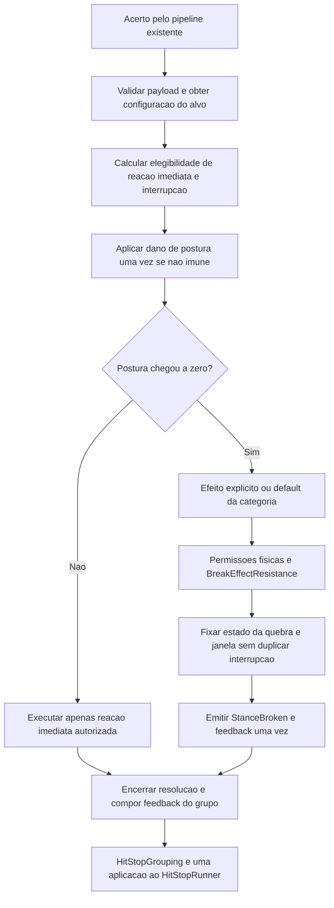

# Design Document

## Overview

Este design detalha a **Fase 2 — Posture & Enemy Interaction**, conforme [requirements.md](requirements.md) e `Docs/Tech-Guy_Gameplay_Rework.md`, §9, §10 e §45. Estende o sistema existente de postura, preservando as APIs e consumidores declarados nos requisitos e a fundação da Fase 1.

A entrega reúne canais independentes de reação, classificação comportamental por alvo, Knockdown, abertura pós-quebra, proteção contra interrupção permanente e feedback audiovisual de quebra. Manopla 2.0, novos boons, mana, reworks de Arco/Lança e estrutura de run permanecem fora de escopo. Pull de inimigo permanece definido conceitualmente; sua execução é adiada porque os consumidores de reação identificados nesta revisão não exigem esse movimento. O pull do jogador pelo Hooker permanece preservado.

**Status:** proposta técnica para revisão e posterior decomposição em tarefas. Descrições do estado atual abaixo resultam de leitura de fonte, não de execução em Unity. Valores novos de balanceamento são propostas iniciais, não critérios de aceitação nem decisões de gameplay já aprovadas.

| Requisito | Responsabilidade principal |
| --- | --- |
| R1 — Independência dos canais | `CombatReactionController`, resolução pura de reação e clamps existentes |
| R2 — Taxonomia | `StanceBreakEffect`, estado de efeitos e executor de Knockdown |
| R3 — Categorias e resistências | `EnemyProfile`, resolução de categoria, `RankReactionDefaults` |
| R4 — Quebra apropriada | `StanceBreakBounds`, `BreakEffectResistance`, `VulnerabilityWindow` |
| R5 — Feedback | apresentação de quebra, `StanceBreakPopup`, agrupamento existente de hit-stop |
| R6 — Relógios e recuperação | estado de efeitos por proprietário, gates de IA e regeneração |
| R7 — Interrupção limitada | `RankInterruptStagger`, `InterruptWindowGate`, política por categoria |
| R8 — Compatibilidade | fachadas existentes, `PlayerActor`, `HookBus`, testes de contrato |

## Architecture

### Camadas e pontos de integração

1. **Autoria:** `EnemyProfile` continua sendo a fonte de parâmetros do alvo; recebe categoria opcional, defaults de quebra e política de reaplicação serializáveis. `RankReactionDefaults` fornece os defaults quando não há perfil. `EnemyVariant` aplica a configuração completa antes do primeiro acerto.
2. **Decisão pura:** os helpers existentes continuam sendo o caminho único para limites, resistência, janela e acúmulo. Novos helpers pequenos resolvem categoria, permissões e propriedade dos bloqueios; não duplicam fórmulas já existentes.
3. **Coordenação Unity:** `CombatReactionController` recebe o payload existente, avança o estado, cancela ataques autorizados e executa movimento/animação. `EnemyAI`, `EnemyCombatActions` e `SectorBoss` consultam a mesma autorização antes de iniciar ações e resolver beats.
4. **Apresentação:** um componente local de feedback recebe a quebra e as transições de janela. Referências de Animator, visual, áudio, VFX e HUD são serializadas ou injetadas. Não há novo singleton nem mecanismo paralelo de hit-stop.

Novas classes de reação ficam em `Assets/_Project/Scripts/Characters/Combat`; apresentação em `Effects` e `UI`, conforme responsabilidade. Assets novos, se necessários para configuração, ficam em `Assets/_Project/ScriptableObjects` ou `Settings`. Nenhuma reorganização de assets existentes é necessária.

### Fluxo de resolução

A coordenação calcula os canais independentemente. `HitReactionType.None` não bloqueia postura; `StanceDamage = 0` não bloqueia uma reação imediata autorizada; ausência de cosmético não muda nenhuma decisão mecânica. O acerto que quebra não executa duas vezes o cancelamento ou movimentos concorrentes da reação imediata e da quebra.

HP e eventos de ataque continuam nos pontos existentes. O processamento mecânico da quebra é síncrono no passo que esgota a postura, independentemente de o chamador estar em `Update`, coroutine ou `FixedUpdate`. Apresentação pode continuar ao longo dos quadros seguintes.

## Components and Interfaces

### Categoria comportamental e rank real

Propõe-se `ReactionCategory { Unspecified = 0, SmallMob = 1, MediumMob = 2, Elite = 3, Boss = 4 }` e `[SerializeField] private ReactionCategory _reactionCategory` em `EnemyProfile`. O zero evita converter perfis antigos automaticamente em uma categoria explicitamente autorada.

| Rank real | Fallback quando categoria não definida |
| --- | --- |
| Normal | SmallMob |
| Elite | Elite |
| Legendary | Elite, com postura/resistência/limiar de Legendary |
| Boss | Boss |

`MediumMob` é uma classificação explícita de perfil, não uma nova raridade. Categoria explícita define o padrão comportamental; rank real continua escalando os dados de resistência e postura. `EnemyRarity`, presente no perfil, não substitui `EnemyRank` nem deve ser convertido por cast numérico.

`EffectiveRank` permanece a leitura temporária da janela. Não governa identidade física, limiar de proteção nem imunidades. A proteção obrigatória contra Launch, Knockdown e deslocamento forte aplica-se a alvos de rank real Boss ou categoria Boss; exceções requerem flags explícitas de perfil para cada canal, além da resistência permitir o efeito. Um perfil com categoria inadequada não remove a proteção do rank Boss.

Sem perfil, resolver rank, categoria, postura e resistências completamente e emitir aviso com `RankReactionDefaults.MissingConfigId(rank)`, uma vez por configuração, sem spam por acerto. Preservar defaults observados de postura 100/220/400/900 e resistências como ponto inicial ajustável, mantendo monotonicidade nos defaults.

### Reação imediata e interrupção

| Categoria | Stagger solicitado | Quebra sem efeito explícito |
| --- | --- | --- |
| SmallMob | Frequente quando elegível; cancelamento somente na janela interrompível | Launch, ou Knockdown autorado |
| MediumMob | Somente solicitado, elegível, na janela e após limiar | Knockdown |
| Elite | Somente na janela, após limiar e fora da proteção de retomada | Janela observável; Stun se permitido |
| Boss | Acertos comuns, inclusive fortes, não cancelam fora da abertura de quebra | Janela observável de boss; Stun se permitido |

`Push` não cancela nem pausa a ação inimiga. O executor atual de empurrão para `NavMeshAgent` precisa separar microdeslocamento de hard CC: não usar `agent.isStopped` como efeito colateral do Push. Deslocamento realizado, inclusive com Rigidbody, deve respeitar 0,5 m por acerto; limitar apenas a força de impulso não demonstra esse limite. Rotação imediata é limitada a 15°. Durante lock, `ControlLockGate` suprime deslocamento adicional, preservando feedback permitido.

`ApplyInterruptStagger` mantém assinatura e retorno. Sua implementação deve primeiro avaliar permissões e acúmulo, e somente depois chamar o cancelamento condicionado por `InterruptWindowGate`. Postura é aplicada exatamente uma vez, inclusive abaixo do limiar. Não converter atingir o limiar em uma quebra artificial quando a reserva não foi esgotada.

Fora do windup, retornar o resultado observável de ausência de interrupção no mesmo passo, sem desfazer um beat resolvido. Uma quebra continua podendo produzir seu efeito e abertura fora do windup. O contexto da decisão distingue acerto comum, contribuição de habilidade de interrupção e quebra; força alta sozinha não autoriza ignorar a política de boss.

### Integração e migração do básico da Manopla

O caminho observado é `CharControlScript` (`Characters/Player/Actions`), execução do básico → `BuildBasicAttackReaction` → `PlayerActor.TryApplyAreaDamage`. Esse builder lê `defaultAttackReaction` e `comboReactions`; o default C# é Push e há `defaultAttackReaction: 1` serializado em CombatStudy, Playground, NexusLobby, FirstSector e PrologueTutorial. O caminho de hitbox em `Weapons/HitboxDamage.TryDamageActor` também aplica reação via `PlayerActor.ApplyHitReactionTo`. `BreakerGauntletCombat` executa habilidades com `AreaHitStep`; `GauntletLoopSteps.Configure` preserva o E e não é o builder do básico. Não assumir que alterar seus passos migra o básico.

Decisão de integração: a configuração do básico da Manopla passa a autorar `Stagger` e contribuição de interrupção positiva por estágio; proposta inicial 1 por acerto elegível. O builder e o caminho de hitbox transportam essa contribuição em extensão aditiva do payload/contexto, sem mudar o construtor público existente. O resolvedor aplica postura uma vez e submete intenção mecânica aos gates de categoria, estado, acúmulo e janela. SmallMob pode cancelar em janela elegível; MediumMob/Elite exigem limiar; Boss real ou categoria Boss recusa interrupção comum independentemente da categoria incoerente do perfil. Push isolado continua sem qualquer contribuição ou cancelamento. Nenhum flinch autoriza controle por si só.

Na implementação, inventariar instâncias de `CharControlScript`, overrides de prefab, `comboReactions`, caminhos de hitbox e configuração da arma equipada. Migrar somente entradas do básico da Manopla de versão legada para versão Fase 2 com `Stagger`/contribuição autorada, em operação Editor explícita e idempotente com preview das alterações. Preservar overrides intencionais de None/Push, registrando-os para revisão, e não transformar entradas de Arco/Lança. Como o componente pode ser compartilhado entre armas, usar dados por arma/estágio ou snapshot de configuração ao equipar, sem trocar globalmente seu default para Stagger. Não alterar HP, alcance, custo, timing ou emissão de callbacks. Inicializador C# não migra valores salvos.

Teste de aceitação usa input e básico reais, tanto direcionais quanto com alvo, não uma chamada manual ao controlador: pequeno interrompe em windup elegível, médio demonstra limitação por limiar e boss mantém seu ataque fora da quebra. Verificar que a migração não duplica `OnBasicHit`, procs nem `AttackHitsResolved`, e que E e caminhos compartilhados com Arco/Lança permanecem corretos.

### Execução da taxonomia

Proposta técnica: extensão aditiva `StanceBreakEffect.Knockdown = 4`, preservando `None = 0`, `Stun = 1`, `KnockUp = 2`, `Knockback = 3`. Manter todos os membros e o construtor existente de `HitReactionRequest`; parâmetros específicos do Knockdown pertencem ao alvo. Novas sobrecargas, se necessárias, são aditivas.

| Efeito | Execução e fallback |
| --- | --- |
| Stun | Lock por duração positiva, sem deslocamento |
| KnockUp / Launch | Altura e tempo pretendidos positivos; trajetória aérea; lock até aterrissagem; obstrução solicita Stun pelo tempo restante, sujeito novamente às permissões/resistência |
| Knockback | Somente pedido explícito; direção horizontal afastando-se do atacante; lock durante deslocamento; obstrução encerra movimento com recuperação segura |
| Knockdown | Derrubada → chão → recuperação; altura aérea zero; duração no chão positiva; bloqueio até terminar recuperação |
| Pull | Direção para a origem; execução de inimigo adiada; sem novo enum executável nesta entrega |

Knockdown usa estado próprio e pose/animação de queda e levantamento. Não é um Stun renomeado. Caso não exista clip adequado, uma apresentação procedural sobre o filho visual pode demonstrar queda, permanência e recuperação, sem rotacionar collider/raiz de navegação. O fallback precisa continuar visualmente distinto de flinch e Launch.

Estender `BreakEffectResistance` com resolução de Knockdown e resistência própria: `Knockdown → Stun → None`. Preservar as escadas existentes `KnockUp → Stun → None`, `Stun → None`, `Knockback → None`. O resumo de R6.8 não deve ser interpretado como permissão para Knockback virar Stun: R2.6 explicita sua escada.

Resistência de hard CC é binária nesta fase: valor <1 permite duração/altura/distância autorada integral; 1 impede o canal. A escala contínua atual por `(1 - resistance)` precisa ser removida desses efeitos como adaptação intencional, com revisão dos testes e apresentação de Fragile. Resistência de stagger e limiar de interrupção mantêm suas funções distintas.

Todo fallback, inclusive por colisão, passa novamente pelo resolvedor de permissões/resistências **antes** de criar tokens ou alterar IA. Launch obstruído + Stun proibido/imune resulta em None físico; liberar só o token da trajetória encerrada, preservando a abertura. `None` no pedido autoriza buscar default; `None` no resultado encerra a resolução física e nunca volta a buscar outro default. Rank real Boss prevalece também no gate de interrupção comum, mesmo com perfil SmallMob. Exceções são explícitas por canal; vulnerabilidade e força alta não são exceções.

### Autoridade de movimento e pose

Um executor local é o único escritor do deslocamento e da pose de reação. Stun e abertura compõem tokens temporais, mas não escrevem trajetórias concorrentes. Efeitos físicos incompatíveis usam prioridade `Knockdown > Launch > Knockback > Push`; mesma prioridade usa a política de reaplicação da categoria. Pedido inferior é recusado sem token físico, embora a quebra/evento/abertura legítimos permaneçam. Pedido superior cancela a geração anterior, encerra sua trajetória na posição segura atual, restaura apenas offsets de pose que ela detinha e inicia a nova; nunca teleporta de volta ao início do movimento antigo.

Launch substituído por Knockdown primeiro encerra o arco e assenta o visual no chão seguro (sem queda atravessando geometria), depois inicia derrubada/chão/recuperação. Knockback durante Knockdown é recusado; a abertura continua com seu token. Callbacks antigos só podem alterar estado se geração e token ainda forem atuais. Animator, pose procedural e pop de escala compõem canais distintos no filho visual; nenhum outro executor de reação escreve esses mesmos offsets. Ragdoll não é habilitado simultaneamente como segunda autoridade nesta fase.

### Quebra e janela observável

A quebra escolhe pedido explícito, ou default do alvo quando `None`; aplica permissões físicas e resistência; fixa o resultado; abre janela positiva mesmo com hard CC resolvido como None; restaura postura ao máximo; fixa imunidade e atraso de recuperação; emite um evento de quebra.

Para Elite/Legendary/Boss, a janela possui uma restrição própria de novas ações ofensivas, independente de hard CC. Em windup, cancelar o ataque e seu beat pendente no mesmo passo. Se o beat já ocorreu, conservar seu dano e encerrar apenas a continuação ainda não resolvida. IA retoma escolhendo nova ação, sem reiniciar a execução cancelada. A abertura não implica multiplicador de HP.

**Contrato consolidado de bloqueios:** hard CC resolvido como None não cria token de hard CC. A abertura de Elite/Legendary/Boss cria um token próprio que suspende ofensiva e navegação pelo seu prazo. `IsControlLocked` representa a união desses bloqueios; `IsStunned` representa somente hard CC físico ativo, preservando a indicação de stun/juggle e incluindo Knockdown/Knockback. A janela isolada não exibe estrelas de stun. Uma janela em Normal não cria o token restritivo de Elite/Boss.

| Estado vivo/ativo | IsControlLocked | IsStunned | Navegação / novas ofensivas |
| --- | --- | --- | --- |
| Sem hard CC e sem abertura restritiva | false | false | Permitidas pelos demais gates |
| Hard CC ativo, sem abertura | true | true | Suspensas |
| Hard CC None, abertura restritiva ativa | true | false | Suspensas pela abertura |
| Hard CC e abertura ativos | true | true | Suspensas |
| Hard CC expira; abertura permanece | true | false | Suspensas |
| Abertura expira; hard CC permanece | true | true | Suspensas |
| Morto/desativado após cleanup | false | false | Proibidas pelo lifecycle |

False nunca é prova de vida. Auditar `EnemyAI.Update/CanAttack`, `SectorBoss`, `ArchetypeBehavior`, `PreferredDistanceLayer`, `HealerBehavior`, `FrontalReflector`, `PlayerActor` (pull do Hooker) e `EnemyCombatFeedback`. Gates de movimento/ataque usam o agregado; indicação de stun usa `IsStunned`; Mirror permanece desprotegido durante a abertura. É adaptação declarada do código atual, onde as propriedades são aliases. R6.9 proíbe apenas o token de hard CC resistido, sem proibir o token independente da abertura.

### Acúmulo, reaplicação e oportunidade de ação

Estender `RankInterruptStagger` com tempo do último valor positivo efetivamente contribuído e reset após intervalo autorado em [0,5; 5] s; proposta inicial 2 s. Acertos rejeitados não renovam esse instante. Usar rank real no limiar e preservar a ordem estrita Normal < Elite < Legendary < Boss para a mesma resistência.

R7.3 pede consumir um limiar por resolução e preservar todo excedente não negativo. O código atual consome todos os múltiplos num `while`. Proposta: consumir somente um limiar por contribuição elegível, sem disparos automáticos em ticks sem acerto; registrar a adaptação e testar entradas maiores que dois limiares.

| Categoria | Reaplicação proposta | Durante lock/imunidade |
| --- | --- | --- |
| SmallMob | Substituir efeito do mesmo tipo, com limite autorado de duração contínua | Preservar excedente; nenhuma nova quebra durante imunidade |
| MediumMob | Ignorar reaplicação do mesmo efeito ativo | Não contribuir para interrupção bloqueada; preservar excedente até decaimento |
| Elite / Boss | Ignorar reaplicação; não renovar abertura por hit comum | Sem contribuição durante abertura/lock; excedente preservado, sujeito ao decaimento |

Para efeitos diferentes, manter proprietários independentes: expirar Stun não solta Knockdown ou abertura ainda válida. Dados de política permitem ignorar, substituir, estender com teto ou limitar; extensões sem teto são inválidas. Definir e validar o teto antes de habilitar extensão em algum perfil.

**Política única de retomada:** para Elite/Legendary/Boss, uma proteção de postura acompanha a abertura e os hard CC da quebra, e continua até concluir a primeira ação ofensiva válida após todos esses bloqueios terminarem. Enquanto protegidos, dano de postura é ignorado, não armazenado; contribuições de interrupção são recusadas e não renovam o decaimento. HP, eventos de acerto e feedback comum continuam normais. Não ocorre nova quebra, evento de quebra ou popup nesse intervalo. Assim, toda quebra efetivamente detectada continua obrigatoriamente abrindo sua janela; não existe quebra anunciada com abertura suprimida.

Essa proteção é um gate de elegibilidade independente da imunidade temporal de [0,1; 10] s. É uma alteração explícita do contrato de postura para satisfazer R7.9, não um novo cooldown universal. Começa ao fixar a quebra, evitando re-quebras durante a própria abertura; o trecho de retomada começa quando todos os bloqueios relevantes terminam. Uma ação válida tem alvo vivo, alcance/caminho e requisitos satisfeitos, uma execução identificada e duração finita; conclui ao terminar seu recovery, tenha seu beat acertado ou errado. A primeira execução iniciada fica protegida contra interrupções comuns, sem imunidade a morte ou cancelamento externo.

Sem alvo, alcance, caminho ou ação elegível, retirar a proteção de retomada no mesmo passo de decisão da IA e descartar qualquer crédito de retomada. Cancelamento externo da ação também encerra a proteção sem rearmá-la. Despawn/morte/configuração nova limpam tudo. Um watchdog local limita o trecho após recuperação a 10 s de gameplay por default (configurável em (0; 10]); expirar libera a proteção, registra a execução problemática e não reabre janela. Ações cujo prazo excede o watchdog são erro de autoria a corrigir antes de aceitar o cenário. O limite é uma saída de segurança, não tempo mínimo de imunidade. Pressão contínua deve permitir uma ação completa nos encontros representativos; não se promete a mesma garantia quando a própria IA é incapaz de agir.

E da Manopla mantém Heavy/Breaker + KnockUp e juggle nos alvos elegíveis. Em boss sem exceção física, KnockUp degrada para Stun permitido e/ou abertura; não remove imunidades pelo `EffectiveRank`. GuardBreaker só gera Knockback quando seu pedido explícito provoca quebra e o alvo permite o canal.

### Relógios e propriedade de estado

Um estado puro por inimigo recebe `now` e `delta` do relógio de gameplay. Coordenação usa tempo escalado; pausa congela efeitos, regeneração, imunidade e acúmulo. Como `HitStopRunner` usa escala quase zero, propõe-se congelar explicitamente o avanço da reação enquanto o runner injetado estiver ativo, evitando expiração residual durante hit-stop. Não criar um segundo controlador de escala.

Esse `now` é acumulado localmente a partir do delta elegível; não é uma leitura direta de `Time.time` que avançaria durante o congelamento explícito. Todos os deadlines do alvo usam a mesma origem, reiniciada na configuração/lifecycle, inclusive `VulnerabilityWindow`, acúmulo e watchdog.

Cada efeito detém seu token de bloqueio e geração de execução. O término libera apenas esse token. Restaurar agente somente se vivo, ativo, habilitado, sobre NavMesh e sem bloqueios remanescentes; preservar paradas externas à reação. Morte, disable, troca de sala e retorno ao pool invalidam a geração, cancelam coroutines, limpam janela/imunidade/acúmulo e restauram apenas offsets visuais. Reativação/configuração nova inicia estado limpo; cleanup nunca revive o alvo.

Regeneração começa após o último dano de postura efetivamente aplicado, à taxa configurada, limitada ao máximo. Dano ignorado pela imunidade ou valor zero não renova o atraso. Uma quebra fixa explicitamente um novo atraso, mesmo após restaurar a reserva.

### Feedback e eventos

Preservar `StanceBroken(Vector3)` e a ponte existente de `PlayerActor` para `HookBus.OnStanceBreak(Actor)`. Não emitir o mesmo hook novamente no apresentador. Registrar uma quebra antes de notificar listeners para evitar duplicação reentrante; handlers podem causar novos acertos, que já encontram imunidade e reserva consistentes.

Antes de alterar a posição relativa dos callbacks, capturar a ordem atual de `OnBasicHit`, `StanceBroken`, `OnStanceBreak` e `AttackHitsResolved` nos pipelines afetados. Preservar essa ordem observável; qualquer diferença necessária para publicar um estado de quebra consistente requer adaptação documentada e teste explícito. Não unificar pipelines assumindo que já possuem ordem idêntica.

Apresentação de quebra inclui animação distinta, som e VFX distinguíveis reutilizando assets existentes, pop de escala de 0,25 s reais e popup de 1,1 s reais apenas onde `ShouldShowStanceBar` permite. Guardar a escala base antes do primeiro pop, restaurando-a também em interrupção/disable; repetir feedback não acumula escala. HUD recebe sinal de início/fim da janela e ícone/estilo de vulnerabilidade para ranks não Normal. Ausência de recurso cosmético registra diagnóstico e não modifica mecânica.

Ponto de impacto deve ser finito. Se inválido, usar posição finita do alvo; se também inválida, usar origem segura e diagnosticar o dado. Direção degenerada usa a relação atacante/alvo quando válida e fallback determinístico caso contrário.

O executor registra a elegibilidade global no resultado imutável do impacto que efetivamente resolveu dano, inclusive dano letal. Morte/disable posterior não apaga essa contribuição. Vida/atividade são revalidadas somente para apresentação local, navegação e controle que dependam do alvo. Contato sem dano resolvido não contribui por estar vivo; candidato de ênfase exige quebra legítima registrada. Compor comum/quebra por `HitStopGrouping.Combine` (máximo), sem soma. Preservar restauração de pausa/modificadores e cleanup da Fase 1.

### Escopo e fechamento do grupo de hit-stop

O executor abre um escopo local antes de resolver seus impactos devidos em um passo do scheduler. Identidade do impacto = `(ExecutionId, ImpactEvent.Index)`; identidade do grupo = id desse lote de resolução. Todos os alvos de um impacto e os impactos simultâneos emitidos nesse lote compartilham o grupo, nunca uma execução inteira ou quadros futuros. O escopo pertence ao executor e é passado explicitamente ao resolvedor; não usa singleton ou estado global/thread-static.

Cada resolvedor registra dano, postura e candidatos antes de executar callbacks públicos. Acertos síncronos reentrantes gerados por callbacks recebem escopo-filho do mesmo grupo e incrementam a profundidade; fechamento aguarda o retorno de todos os filhos. Um impacto externo sem escopo recebido cria seu próprio grupo de uma chamada; chamadas independentes no mesmo frame não são agrupadas implicitamente por relógio. Sobrecargas internas transportam contexto sem alterar as fachadas públicas atuais.

Somente o proprietário externo finaliza, após dano/postura, callbacks de hit/break e `AttackHitsResolved` síncronos. Em `finally`, fecha uma única vez, mesmo em erro, cancelamento ou retorno antecipado, usando apenas resultados já confirmados; os demais candidatos são descartados. Feedback comum e listeners de quebra apenas adicionam candidatos e não chamam o runner. Ao fechar, uma decisão conjunta e no máximo uma chamada a `HitStopRunner.Apply`; duração zero ou nenhum candidato válido produz zero chamadas. Fechamento não reemite eventos de gameplay. Impactos assíncronos posteriores abrem outro grupo. Auditar `BreakerGauntletCombat.EmitAuthoredImpact/ApplyHitStopForImpact`, que atualmente chama o runner depois de cada impacto individual.

## Data Models

| Dado proposto | Local | Contrato |
| --- | --- | --- |
| `ReactionCategory` | Enum + `EnemyProfile` | Zero = não especificado; fallback determinístico |
| Configuração de reação | Struct serializável em perfil | Default de quebra, resistência Knockdown, durações, política e limites |
| Exceções físicas de boss | Campos explícitos do perfil | Flags independentes para Launch, Knockdown e Knockback; false por default |
| Configuração resolvida | Modelo puro runtime | Dados já validados, rank real e categoria; não substituir dados brutos de autoria |
| Estado de efeito | Modelo puro runtime | Tipo, fase, início/fim, token e geração; intenção de trajetória |
| Estado de abertura | `VulnerabilityWindow` + autorização | Temporizador existente, sinais de transição e restrição ofensiva |
| Contexto de resolução | Runtime local | Identidade do impacto, origem e resultado; sem novo estado global |

Usar `[Serializable]` e campos compatíveis com Unity para autoria. Não serializar o estado runtime ou depender de readonly properties como backing data do Inspector. Acrescentar campos sem renomear os existentes; eventual renomeação exige `FormerlySerializedAs`. Auditar switches, assets, prefabs e consumidores do enum antes de adicionar Knockdown.

### Autoria, migração e impacto cruzado

Dados novos recebem versão de configuração e sentinel para distinguir ausência de override de um zero intencional. Perfis antigos usam categoria Unspecified, sem exceções de boss, default de quebra resolvido por categoria e resistência de Knockdown derivada de Stun até autoria explícita. Propostas iniciais de duração: Knockdown derrubada 0,2 s, chão 0,8 s e recuperação 0,3 s; Launch default 2 m/1 s; Stun default 1 s; teto de controle contínuo SmallMob 5 s; decaimento 2 s; watchdog de retomada 10 s. Validar fases positivas e soma de durações de efeito ≤10 s. Esses números permanecem ajustáveis no balanceamento.

Migração futura via Editor tem preview, seleção explícita e relatório por campo; é idempotente e preserva GUIDs, HP, timing e overrides não relacionados. Autorar `Archetypes/Heavy.asset` como representante MediumMob no cenário de validação, mantendo seu rank real e stats, e Grunt/Fragile como SmallMob. Apenas adicionar enum não altera assets antigos. Persistência deve ser conferida após salvar/recarregar tanto perfis quanto overrides das cenas; nenhum asset foi migrado nesta revisão.

Impacto binário: `CombatReactionController.TriggerStanceBreak`, `StartKnockUp` e `ScaleDuration` hoje escalam CC por resistência; Knockback também escala distância. Ao mudar para binário, Heavy com resistência 0,25 recebe duração integral quando permitido. Fragile com resistência zero continua recebendo o launch integral, mas deixa de ter airtime maior que um alvo idêntico com resistência não zero e <1. A comparação antiga de `enemy-swarm-core-archetypes/requirements.md` R17.4 é incompatível com o novo contrato; revisar essa expectativa e seus testes antes de implementar, mantendo cobertura de lançamento, duração integral, imunidade e cleanup. Não adicionar um multiplicador oculto para fingir que ambos os contratos foram preservados.

## Error Handling

Validar dados **brutos** em `OnValidate` antes de getters que fazem clamp. Mensagem identifica asset/componente, campo e faixa. Não executar gameplay nem escrever correções silenciosas no asset. Runtime usa fallback seguro independente do diagnóstico.

| Parâmetro | Validação |
| --- | --- |
| Resistências | Finitas em [0; 1] |
| Multiplicador de postura | Finito em [0; 5], conforme `StanceBreakBounds` |
| Imunidade / atraso de regeneração | [0,1; 10] s / [0; 10] s |
| Janela | Positiva, finita, limites de `VulnerabilityWindowBounds` |
| Pop / popup | [0,20; 0,30] s / [1,0; 1,2] s reais |
| Decaimento de interrupção | [0,5; 5] s de gameplay |
| Postura máxima / regeneração | Finita, ≥1 / finita, ≥0 |
| Durações executáveis / trajetória | Finitas e positivas quando o efeito exige duração/altura/distância |

Não inventar limite superior de postura ou regeneração como aceitação: explicitar limites de autoria se adotados no balanceamento. Novas durações de efeito e tetos precisam de faixa finita documentada; proposta inicial (0; 10] s, a revisar. NaN/infinito nunca chegam ao relógio, NavMesh ou evento. Referências obrigatórias são verificadas em `Awake`/`OnValidate`; agente fora de NavMesh impede movimento naquele passo, sem lançar erro repetido ou alterar o contrato de quebra.

## Correctness Properties

As propriedades conectam os requisitos a testes de lógica pura; cenários de Animator, NavMesh, serialização e percepção exigem testes Unity ou playtest.

| Propriedade | Invariante | Validates: Requirements |
| --- | --- | --- |
| 1 — Independência | None permite postura/quebra; None + postura zero não move nem interrompe; cosmético não altera mecânica | 1.1, 1.2, 1.6, 7.2 |
| 2 — Limites imediatos | Push/Stagger ≤0,5 m e ≤15°; Push nunca cancela; lock suprime deslocamento extra | 1.3, 1.4, 1.7, 6.6, 6.7 |
| 3 — Identidade | Categoria resolve determinística; EffectiveRank não muda rank real/imunidades; fallback sem perfil é completo | 3.1, 3.7–3.9, 4.3, 4.8 |
| 4 — Efeito de quebra | Pedido precede default; Knockback nunca é default; resolução não escolhe canal imune | 1.5, 2.1–2.6, 4.2, 6.8 |
| 5 — Quebra única | Cruzamento para zero produz uma quebra no mesmo passo, restaura reserva e abre janela mesmo com CC resistido | 4.1, 4.5–4.7, 5.1, 5.2 |
| 6 — Acúmulo | Limiar monotônico; abaixo dele não cancela; consumir um limiar preserva excedente; reset mede última contribuição | 7.1–7.4, 7.8 |
| 7 — Cancelamento | Categoria/limiar precedem gate; cancelamento autorizado suprime beat pendente; beat passado não é desfeito | 7.5, 7.6 |
| 8 — Recuperação | Expirar token não libera outro; cleanup invalida geração; regeneração não ultrapassa máximo | 6.1–6.5 |
| 9 — Reaplicação limitada | Proteção ignora postura sem gerar quebra/evento; toda quebra detectada abre janela; retomada possui saídas verificáveis | 4.4, 7.7, 7.9, 7.11 |
| 10 — Feedback separado | Dano letal conserva contribuição global; contato sem dano não contribui; fechamento produz máximo e uma aplicação por grupo | 5.8–5.10, 8.11 |
| 11 — Compatibilidade | Assinaturas/valores existentes preservados; eventos mantêm payload, granularidade e ordem auditada | 8.1–8.5, 8.8–8.10 |
| 12 — Fallback autorizado | Obstrução nunca contorna imunidade; None resolvido encerra a física; Boss incoerente continua protegido | 2.6, 3.8, 7.12 |
| 13 — Movimento exclusivo | Uma autoridade por trajetória/pose; prioridade determinística; geração antiga não altera o efeito novo | 2.1–2.4, 6.2, 6.3 |
| 14 — Bloqueios observáveis | Abertura isolada trava controle mas não marca stun; expiração libera apenas seu proprietário | 4.4, 6.1, 6.2, 6.9 |

## Testing Strategy

**EditMode:** seguir o harness `PropertyCheck` adotado nas specs recentes do projeto, com ≥100 casos determinísticos por propriedade de lógica pura e relato de seed/contraexemplo. Tags: `// Feature: posture-enemy-interaction, Property {n}: {text}` e `// Validates: Requirements X.Y`. Casos exemplo cobrem zero, limite exato, acima do limite, NaN, infinidades, resistência 1, contribuição acima de dois limiares, falta de perfil e enum desconhecido.

Reusar e ampliar testes existentes de independência, janela, resistência, imunidade, juggle e interrupção. Executar `CompatibilityContractPlayModeTests`, `HookBusWiringExampleTests`, `BasicHitChannelPropertyTests`, `GuardBreakerPropertyTests` e `GuardBreakerKnockbackPlayModeTests`. Mudanças categóricas justificam expectativas novas somente com registro do comportamento antigo, contrato novo e cobertura equivalente. Não enfraquecer uma asserção correta para acomodar implementação defeituosa.

**PlayMode/integração:** testar quatro categorias e Legendary; None que quebra; Knockdown completo; Launch/Knockback contra obstrução; Push durante ataque sem cancelamento; E contra comum e boss; CC totalmente resistido; locks sobrepostos; morte/disable/pool/troca de sala; pressão contínua com imunidade menor que a abertura; grupo multi-alvo com múltiplas quebras e alvo morto; pausa/slow-motion/hit-stop; persistência de perfil após salvar/recarregar. Verificar callbacks em ordem, HP, projéteis, firing-on-the-move e timing de Arco/Lança nos caminhos afetados.

**Validação obrigatória na implementação:** descobrir Unity MCP, confirmar projeto/Editor, capturar Console inicial sem limpá-lo, importar alterações, aguardar compilação e executar testes suportados. Inspecionar perfis/prefabs/cenas e seus valores serializados, entrar em PlayMode para cenários representativos e sair preservando estado de cena. Se MCP falhar, registrar tentativa e limitação; alternativas não substituem checks Unity suportados.

**Gate manual:** Manopla sem boons contra pequeno, médio, elite e boss. Registrar se categoria e quebra são reconhecíveis sem ler barra, se o Knockdown comunica seu ciclo e se Elite/Boss voltam a agir. Aprovação técnica e aceitação de gameplay são resultados separados.

### Cenários adicionais exigidos pela revisão

| Cenário | Evidência esperada |
| --- | --- |
| Básico real Manopla em pequeno/médio/boss | Input passa pelos dados migrados e produz diferenças por categoria, uma resolução de dano/procs |
| Golpe letal em único alvo | Uma contribuição global e hit-stop válido; nenhum controle local do cadáver |
| Boss imune a todo hard CC | IsControlLocked=true pela abertura, IsStunned=false; IA suspensa e depois retomada |
| Launch obstruído + Stun proibido | Nenhum token de Stun; abertura legítima preservada |
| Rank Boss + categoria SmallMob | Nenhuma interrupção comum nem imunidade física removida |
| Pressão durante abertura/retomada | HP normal; postura ignorada; sem evento de quebra fictícia ou dano adiado |
| Retomada sem alvo/caminho/ação e cancelamento externo | Saída no passo de decisão, sem rearmar; watchdog cobre execução excepcional |
| Launch → Knockdown → Knockback | Assentamento seguro, Knockdown prevalece e callback antigo não move/solta alvo |
| Multi-alvo, reentrância, erro e retorno antecipado | Escopo fecha uma vez, com candidatos confirmados e eventos por alvo |
| Assets antigos e Heavy MediumMob | Preview idempotente, overrides preservados e dados sobrevivem ao reload |

Propriedades 12–14 recebem testes puros; o cenário do básico real, trajetórias, fechamento no executor e persistência exigem integração. ≥100 casos gerados não substituem esses cenários.

## Requirements Coverage Map

| Critérios | Seções / evidência prevista |
| --- | --- |
| R1.1–R1.7 | Fluxo, reação imediata; propriedades 1–2 e PlayMode de Push |
| R2.1–R2.6 | Taxonomia; propriedade 4 e trajetórias/ciclo reais |
| R3.1–R3.9 | Categoria e dados; propriedade 3, validação de perfis |
| R4.1–R4.9 | Quebra/janela, relógios, erros; propriedades 3, 5, 9 |
| R5.1–R5.10 | Feedback/eventos; propriedades 5, 10–11 e inspeção audiovisual |
| R6.1–R6.9 | Estado por proprietário, taxonomia e semântica consolidada; propriedades 4, 8, 13–14 |
| R7.1–R7.12 | Acúmulo, retomada e migração do básico; propriedades 6–9, 12 e cenários reais |
| R8.1–R8.11 | Fachadas, dados, eventos e testes de contrato; propriedade 11 |

## Decisions and Handoff

Este documento constitui o handoff arquitetural da etapa; não requer relatório Markdown adicional. Afeta o controlador e helpers de reação, configuração de inimigos, gates de IA/boss, apresentação e integração com executores/eventos. A razão para estender essas peças é cumprir os novos comportamentos por categoria sem substituir a fundação já consumida por armas e boons.

**Propostas técnicas detalhadas:** categoria com sentinel e fallback; Legendary usa comportamento Elite com dureza própria; Knockdown aditivo com resistência e ciclo próprios; Pull de inimigo adiado; CC binário; estado de bloqueio por proprietário; feedback agrupado pela fundação da Fase 1.

**Contratos fechados nesta revisão:** hit-stop letal preservado; básico da Manopla com intenção mecânica explícita e migração de autoria; locks agregados com distinção de stun; fallback sempre autorizado; proteção de postura sem quebra fictícia; autoridade única de movimento; escopo local de agrupamento. `requirements.md` foi sincronizado em R5.9, R6.9 e R7.11–R7.12. Essas alterações documentais não constituem implantação nem aceitação de gameplay.

**Rastreabilidade da fonte:** `Characters/Combat/CombatReactionController.cs`, métodos `ApplyInterruptStagger` (cancelamento antes de acúmulo), `TriggerStanceBreak`, `ScaleDuration`, `StartKnockUp` (CC parcial) e propriedades `IsControlLocked/IsStunned` (aliases); `Characters/Combat/RankInterruptStagger.cs`, `Accumulate` (consome múltiplos limiares); `Characters/Player/Actions/CharControlScript.cs`, `BuildBasicAttackReaction` (Push legado); `Abilities/Weapon/BreakerGauntletCombat.cs`, `EmitAuthoredImpact/ApplyHitStopForImpact` (aplicação por impacto). São observações estáticas confirmadas na revisão, não testes de runtime.

**Pendências antes da implementação:** validar números e clips/poses com gameplay; reconciliar R17.4 de Fragile na spec de arquétipos e seus testes com CC binário; concluir auditoria de ordem de callbacks por pipeline e inventário de migração. Não gerar tasks executáveis enquanto essas dependências de contrato cruzado não estiverem reconciliadas.

**Próximas ações:** revisar a proposta consolidada e fechar as dependências cruzadas acima. Somente depois decompor em `tasks.md`: dados e lógica pura → migração do básico e gates → efeitos/lifecycle → feedback → regressão/playtest. Esta revisão não cria tasks nem implementa código.

**Verificação desta revisão (02/10/2026):** Unity MCP confirmou uma instância `Tech-Guy@fccafb2b47cd7671`, projeto `D:/Dev/Personal/My_games/Tech-Guy`, Unity 6000.5.10f1, cena MainMenu, fora de PlayMode e sem compilação ativa. Descobertos recursos/capacidades e consultados Console e inventário completo de 19 EnemyProfile; metadados de Heavy e Fragile confirmados pelo Editor. Valores de Heavy (postura 220, KnockUp 0,25) e Fragile (postura 30, KnockUp 0) foram lidos dos arquivos serializados, não de uma inspeção de propriedades no Editor. Console retornou aviso preexistente CS0108 em `Core/ScenePortal.cs:107`; não foi limpo. Nenhuma cena carregada/trocada, asset migrado ou código alterado. Não foram executados compilação solicitada, testes, persistência, runtime ou playtest. Inventário/metadados não provam referências corretas nem apresentação válida; esses checks permanecem pendentes.

**Registro histórico do primeiro incremento (02/10/2026):** tarefas 1–2 reconciliaram os contratos de Heavy/Fragile com CC binário e registraram baseline/auditoria em contract-audit.md. Dados e modelos puros começaram com 29 testes EditMode aprovados via MCP.

**Implementação integrada:** controlador, gates de IA, movimentos, lifecycle, migração de quatro assets, básico/E da Manopla e feedback agrupado implementados. EnemyVariant configura a reação antes do primeiro hit e preserva seu estado no Start. Receipt local de dano garante agrupamento mesmo com cura/reentrância/exceção posterior. Hit-stop comum usa o perfil autorado da Manopla (0,05 s no asset atual); outras armas preservam timing comum anterior, e quebra confirmada prioriza 0,09 s. Altura Launch é limitada a 4 m, além da validação de NaN/infinito. Pose, VFX e SFX locais procedurais suprem a ausência de clips específicos/AudioClips. Evidências atuais e regressão estão em `validation.md`; números e legibilidade continuam sujeitos ao gate humano 17.

## Integração de recibos — Manopla 2.0 (03/10/2026)

Uma quebra real recebe sequência causal local ao CombatReactionController. No impacto contextualizado da Manopla, HP e postura são resolvidos independentemente e os ganhos de energia são consolidados antes dos callbacks públicos. Os eventos conservam contagem e ordem relativa; a terceira quebra da mesma raiz continua abrindo vulnerabilidade e emitindo StanceBroken, mesmo sem novo bônus de energia. Não há alteração da política de resistência, imunidade física, stun ou abertura da Fase 2. Rotas sem contexto mantêm publicação imediata e o comportamento existente.
