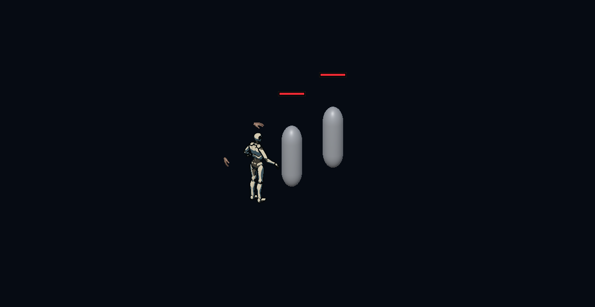
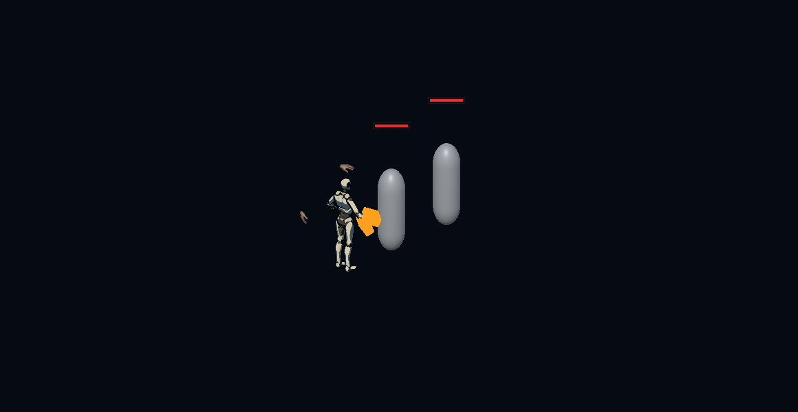
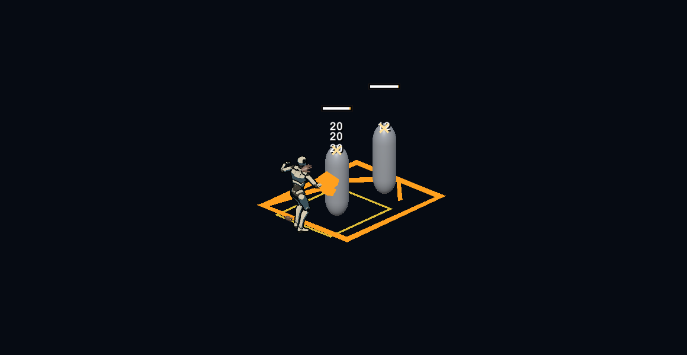
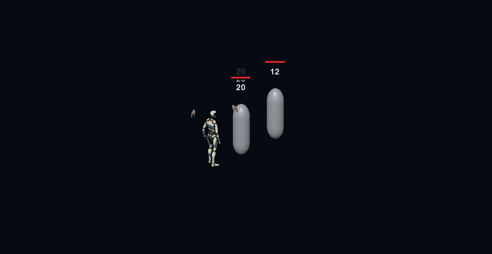

# GPR-01.2 — Punhos Titânicos

28/10/2026 · **IMPLEMENTAÇÃO CONCLUÍDA COM RESSALVA DE REGRESSÃO; REVISÃO DO DESENVOLVEDOR PENDENTE.** **STOP antes de GPR-01.3.**

## Autorização, preparação e limites

Executada somente a primeira Mutation jogável da Manopla, conforme [pedido direto](AUTORIZACAO_GPR_01_2_20261028.md). GPR-01.1 foi aceita tecnicamente pelo desenvolvedor: seus 210 casos históricos não são uma nova execução nem uma certificação da suíte global. Não há aceite humano de Punhos Titânicos.

Projeto confirmado pelo MCP: `D:/Dev/Personal/My_games/Tech-Guy`, Editor `6000.5.10f1`, instância `Tech-Guy@fccafb2b47cd7671`. Input System 1.20.0, Navigation 2.0.14 e Test Framework 1.7.0 preservados. A pasta de trabalho antiga do chat não foi usada para editar o jogo. HEAD inicial `37fa43fca5b09115c46704ccd6f01ddadb089360`, branch `gameplayOverhaul`, árvore inicialmente limpa. NexusBlockout limpa em Edit Mode; nenhuma sessão humana ativa observada. O servidor inicialmente recusou conexão; foi iniciado pelo painel MCP do próprio Editor e a conexão real foi confirmada antes da implementação.

Lidos AGENTS.md, quatro skills locais e referências, relatório01.1, fatia vertical, requisitos/design/tasks, combate/armas/boons e matriz. A divergência de caminho no relatório01.1 é histórica: o projeto desta execução foi identificado novamente pelo MCP, sem assumir a instância anterior.

## O que foi implementado

`TitanicFistsDefinition` registra `mutation_gauntlet_titan_fists`, título **Punhos Titânicos**, no `BoonExpansionCatalog` já executável. É uma Mutation de rank único, Gauntlet/Basic explícito, com transformação de geometria e interação condicional. O card explica LMB, terminal confirmado, novas vítimas, números experimentais e restrições. `Any` continua15; Bow/Spear não recebem essa oferta. Nenhum `.asset` de catálogo existente foi regravado: a definição segue o padrão de expansão executável já usado pelo projeto.

O scheduler básico existente continua decidindo contato e terminal autorado. Após o batch nativo de HP/notificações/feedback, `CharControlScript.BasicImpact` encaminha pose e dimensões ao `ProtocolRuntime`. O snapshot aceito precisa conter a Mutation; a aquisição não modifica um ataque já aceito. Sem HP nativo confirmado, não existe reserva para causar dano secundário. Whiff, imunidade, estágio intermediário e aquisição ausente são negativos testados.

`ProtocolRuntime.TitanicFists` é uma extensão parcial do owner existente. Reserva um filho com **ProtocolBasicEffects.None**, preserva raiz/parent, sessão, encontro, budgets e clocks. Guarda apenas trabalho autorizado durante o hitstop; processa depois, com `CanResolveBasicBranch` e delta escalado válidos. O filho pode manter a raiz após fechamento normal do soco. Troca de contexto, disable, encerramento e cena invalidam futuros; pausa suspende. Não há novo executor, scheduler, serviço de recompensa, causal root ou pedido automático de LMB.

Onda instantânea em caixa: consulta bounded NonAlloc do runtime, alvos ordenados por identidade, dedupe por ator e por handle/geração na linhagem, membership do encontro e LOS contra sólidos. Reutiliza `QueueDamage`/`DrainDamage` e receipts/analytics existentes. A fila da onda guarda sua reserva e a revalida em cada commit; uma raiz retida por itens na fila não pode continuar causando dano depois de o filho ser revogado. Vítimas nativas são excluídas. Não aplica postura/CC, mana, Asura ou hooks nativos extras. Não concede Conductor, Detonation, Ignite/Frost/Resonance ou composição A+B/C; o comportamento nativo dos Protocols continua existente.

### Dados experimentais e referência exata

| Dado | Valor e referência |
|---|---|
| ID/alvo/rank | mutation_gauntlet_titan_fists / Manopla Basic /1 |
| Alcance/largura |1,5× os valores efetivos do soco capturados no contato, incluindo escala vigente; dimensões vazias usam o mesmo fallback de PlayerActor |
| Altura |A mesma altura resolvida do soco; sem expansão vertical |
| Origem/direção |Pose comprometida no contato nativo; caixa avança a partir dessa origem |
| Dano |0,60× o **maior dano pré-mitigação dentre receipts nativos positivos daquele terminal** |
| Referência de dano |Pacote já rolado pelo básico, após modificadores do atacante e antes da mitigação da vítima; crítico do pacote já está incluído. Máximo evita dependência da ordem de colliders; não usa HP efetivo/overkill como base de tuning |
| Coeficiente |Aplicado uma vez ao preparar a onda; não rerrola crítico nem reaplica os multiplicadores do atacante; TakeDamage mantém mitigação/imunidade de cada nova vítima |
| Limites |Uma reserva por terminal; budgets/32 impactos da raiz e caps de query/sight/queue existentes; sem renovação |
| Tuning |Constantes públicas concentradas em TitanicFistsDefinition; nenhuma mudança nos números autorados do básico ou dash |

O receipt ganhou `SourceDamage`, com validação finita/positiva e argumento opcional compatível. HP confirmado continua sendo `Damage`, sem substituir o total de analytics pelo pacote pré-mitigação. Nenhuma dessas constantes representa aprovação final de balanceamento.

## Aquisição e lifecycle

O fluxo de oferta usa `ManualRewardCatalog`→draw/ticket→`RunBoons.Choose`→aquisição existente→refresh que preserva timers. Nenhum peso, oportunidade, política, gate de Mutation ou limite foi ampliado.

O teste de aquisição natural usou seed **0**, rota válida de fixture, percurso1→2→4→5, escolhas anteriores por tickets e Mutation no node5/ordinal0. Ofertas: Cadenciada, Punhos Titânicos e Uppercut do Eclipse; escolha contabilizou exatamente uma Mutation e resolveu o ticket. Repetir a escolha foi rejeitado. [Registro](../validation/artifacts/gameplay-rework/gpr-01-2/reward-ticket.json). **Não houve grant de debug nesse teste**, mas travessia/conclusão dos encontros foram automatizadas pelas autoridades da rota: isso não é uma run física completa em FirstSector nem prova da frequência em todas as seeds.

Os testes mecânicos/visuais separados podem conceder o boon pelo adapter de aquisição para isolar o efeito; isso está explicitamente marcado e não é usado como prova de oferta natural. Aquisição preservou quatro cooldowns, mana e energia. Sem boon, base intacta; troca para outra arma elimina manifestação/futuro, retorno ao contexto adquirido restaura a sobrepeça; fim/reinício de run e cena eliminam estado antigo. Sem implementação de swap universal de habilidades.

## Visual e capturas reais

`TitanicFistsVisual` cria uma sobrepeça angular na mão existente e reutiliza um LineRenderer de onda frontal âmbar com seta. Não escala ossos, colliders ou hitboxes. Material é local, destruído no teardown; wave é reutilizada e limpa. Não há alteração de modelo, rig, animação, cena ou prefab. A onda é apresentada com reserva, query e capacidade de impacto válidas, inclusive sem vítima nova; a consulta de capacidade é somente leitura e não consome impacto vazio. Negação/revogação não produz a onda ou HP novo.

Capturas1160×600 da **Game View real do Unity**, em fixture isolada com o rig/controlador/arma publicados, alvos de cápsula e câmera de evidência. O boon foi concedido de forma assistida somente para esse comparador. Três comandos aceitaram os estágios autorados e a onda alcançou alvo a2,65m, fora da frente nativa2,05m, com **12HP** adicionais. Não é playtest físico ou aprovação artística.

Quatro imagens finais abertas e inspecionadas. Uma captura intermediária de base vazia revelou interferência de câmera; a fixture foi isolada e as quatro imagens refeitas no Unity, sem edição de pixels. O caso de onda autorizada sem vítima adicional passou sem consumir quota de impacto ou repetir dano na vítima nativa. A apresentação é geométrica/provisória; ambiente de fundo escuro e cápsulas não certificam legibilidade em mapas com perigos e muitos VFX. O visual nativo amarelo permanece independente da onda âmbar.

## Validação Unity e investigação de regressões

Resultados observados no código de produção atual, sem alegação de suíte global:18/18 focados,90/90 EditMode e187/187 na última regressão ampliada, sem ignorados.295 nomes distintos finais; não é suíte global. Ocorrências intermitentes anteriores continuam registradas e não foram declaradas corrigidas pela nova rodada verde. Artefatos completos e seletores ficam em [gpr-01-2](../validation/artifacts/gameplay-rework/gpr-01-2/).

- Foco final: **18/18**, zero ignorados, job8cce2d5baf4a44209f2bde148c7c2576,8,453438s. Inclui combo real base/A, aquisição por ticket, geometria/LOS, receipt/coeficiente/atribuição, imunidade/whiff, dedupe/pooling, caps, pausa, troca, nova run/cena, recursos/timers e capturas.
- Crowd:8/32/64 alvos→8/32/32 atingidos;8/32/32 tentativas de impacto. Conclusão55,4372/59,4102/66,8758ms **incluindo hitstop e frames**. Não é tempo CPU da query nem benchmark de build/GC; a restrição em64 prova manutenção do cap, não ausência de saturação.
- Bateria ampliada inicial:184/187, três negativos reais. Isolados,3/3 passaram; isso não foi tratado como correção.
- Comparação no mesmo Editor com fontes de HEAD e novas fontes temporariamente excluídas, GUIDs intactos:185/187; Avanço e Arco falharam também sem a mutação. Assembly confirmou ausência de TitanicFistsDefinition. Todos os12 fontes foram depois restaurados de cópia verificada, sem git reset. [Comparação](../validation/artifacts/gameplay-rework/gpr-01-2/baseline-regression.json).
- Hipótese concreta de fixture: Camera.main de uma cena anterior interfere na mira do executor, enquanto a fixture projeta o cursor por sua própria câmera ou presume ausência dela. Ajustadas apenas as duas fixtures para desabilitar/restaurar câmeras preexistentes durante seu escopo. Mesmas asserções, dano, tolerâncias e tempos.
- Burn saturado:192/256 em uma bateria conjunta;256/256 no isolado e em HEAD. Causa temporal não demonstrada conclusivamente; nenhuma correção do scheduler, mudança de tolerância ou garantia contra hitch foi declarada.
- Tentativa inicial de compilação da nova fixture acessou campo privado; corrigida por reflexão. Job063f1bad… foi cancelado na inicialização, zero casos válidos. Uma rodada intermediária selecionou14/15 porque o método de crowd ainda não estava na assembly carregada; foi detectado por comparação de seletores/resultados e repetido com assembly atual. Não somar esses casos como15PASS.

Os dois casos novos de reentrância falharam0/2 antes da correção: EndOwnedState invalidava a iteração de futuros; swap ainda permitia dois receipts em vez de um. Corrigidos índice após cleanup e reserva obrigatória por item da onda; mesmas asserções passaram na rodada17/17. `ProtocolRuntime.Damage` só exige esse token quando informado, preservando o comportamento nativo fora da nova onda. O EditMode inicial89/90 encontrou uma lista esperada sem o novo ID autorizado; acrescentado somente Punhos Titânicos à expectativa exata da Manopla, mantendo igualdade de listas e exclusão nas outras armas.

A bateria após o guard da fila teve186/187, falhando HitStopPreservesRecoveryIntentWithoutUsingItsRealTimeForExpiry: distância do destino11,798543 vs tolerância0,1. O caso, MovementDuringRecoveryKeepsTheCast_UsesLatestValidOrderOnce e burn passaram3/3 no diagnóstico isolado (job88f8633924624e5d81cab3183813ab30). A causa dessa ocorrência não foi demonstrada e nenhum clock/TTL/assert foi relaxado. A última bateria187/187 passou sobre os fontes finais (jobd064e012a3ae4fb1830b136d4845da1c,93,0416736s); isso não encerra a pendência de intermitência.

EditMode final90/90,137,3132595s, job82b5fd3cb02b45668d4d87ef5feaf580. Detalhes: [focados](../validation/artifacts/gameplay-rework/gpr-01-2/mutation-release-final.json), [EditMode](../validation/artifacts/gameplay-rework/gpr-01-2/edit-final.json), [regressões](../validation/artifacts/gameplay-rework/gpr-01-2/regression-release-final.json), [contagem sem duplicatas](../validation/artifacts/gameplay-rework/gpr-01-2/test-summary.json). Os295 nomes só somam essas três seleções, sem reutilizar intermediários/diagnósticos.

A definição real de produção foi configurada num catálogo temporário, salva, descarregada e recarregada pelo Unity: ID/título/Basic16/rank1 e parâmetros1,5/0,60 confirmados. A exclusão em código foi inicialmente bloqueada pelo guard do MCP, sem executar a operação; criação/leitura e cleanup foram realizados depois pelas operações dedicadas. Asset e meta temporários ausentes ao fim. Não é teste de save/resume da run inteira.

NexusBlockout restaurada limpa em Edit Mode, GUIDd9c5ad58160cf614e984e1c4f2599d39, compilação válida/0 missing scripts/0 dispositivos GPR/Titanic remanescentes. Console nativa:0 erros/526 avisos/270 logs, sem Clear manual. Os avisos amostrados incluem dependências ausentes em fixtures (dash/câmera/click) e keys legadas. read_console classificou uma linha Debug.Log de diagnóstico ChargedShot como Exception; contadores nativos GetCountsByType do Editor6.5 confirmaram0 erros. Divergência registrada, sem alterar o plugin ou declarar Console sem avisos.

O checker genérico da skill falhou com exit1 ao resolver pacote externo entre C: e D: (`os.path.relpath`, Tripo3D); é falha da ferramenta, não PASS nem diagnóstico de GUID inválido do projeto. Não se editou pacote externo para contornar. Integridade focal, importação/compilação e referências foram verificadas separadamente e têm alcance próprio.

## Integridade e persistência

Inventário inicial de1794 arquivos protegidos;13 fontes existentes alteradas intencionalmente,1781 iguais e zero ausentes. Nenhuma cena/prefab/asset/meta/configuração preexistente mudou. Quatro metas novas geradas pelo Unity; zero GUIDs duplicados em Assets/_Project. O checker genérico não certificou Assets inteiro.

O novo runtime não escreve PlayerPrefs, saves ou progressão persistente. As fixtures existentes de RunSummary/prefs restauram suas chaves nos respectivos scopes; os alvos mecânicos novos removem CoinDrop. Não houve baseline independente universal de PlayerPrefs nesta atividade nem certificação de save/resume da run inteira; não apresentar a inspeção de fontes/artefatos como esse teste.

## Arquivos e skills

Novos fontes: TitanicFistsDefinition.cs, ProtocolRuntime.TitanicFists.cs, TitanicFistsVisual.cs e TitanicFistsPlayModeTests.cs, com quatro metas geradas pelo Unity. Fontes existentes: GauntletImpactContext.cs, ProtocolBudget.cs, ProtocolRuntime.cs, ProtocolRuntime.Damage.cs, PlayerActor.cs, CharControlScript.BasicImpact.cs, BoonExpansionCatalog.cs, RunBoons.cs e GPR01FoundationTests.cs. Fixtures de isolamento: DirectMovementIntegrationPlayModeTests.cs e BowBoonPlayModeTests.cs. Atualizada a expectativa de catálogo em EditMode/Editor/BoonOfferCompatibilityTests.cs. ManualRunRewardPlayModeTests.cs agora verifica o ID e o alvo corretos também quando o primeiro card legal é a Mutation Basic; mantém contagem/ticket, sem presumir apenas o enum legado. Nenhum executor de Bow/Spear ou navegação de produção alterado.

Documentos: README, este relatório, autorização recebida, estado/lacunas, progresso mestre, matriz, requisitos, desenho técnico, tasks, fatia vertical e atualização de boons. Ferramenta: Tools/GameplayObservation/gpr_01_2_mcp.py; evidências na pasta da atividade, sem substituir resultados históricos. Três writers legados gravaram nos destinos antigos durante a regressão final; a evidência nova foi copiada para gpr-01-2 e os três originais foram restaurados de HEAD (árvore inicial limpa). Ver historical-output-restoration.json.

Skills efetivamente lidas/aplicadas: tech-guy-game-vision, tech-guy-combat-unity, tech-guy-boon-design e tech-guy-unity-acceptance com referências locais; router, unity-csharp-scripting, unity-scriptableobjects, game-feel e unity-mcp-orchestrator instaladas em C:/Users/gabri/.codex/skills. Computer Use auxiliou conexão/inspeção do Editor. Diretrizes genéricas6.3 foram adaptadas a6000.5.10f1; nenhum pacote foi atualizado. Não foi presumida uma skill dedicada de testes Unity ausente; validação usou acceptance local e MCP real.

## Reprodução

Com o projeto correto conectado ao MCP local, reutilizar os seletores `mutation-final.request.json`, `play-regression.request.json` e `edit-final.request.json` na pasta da atividade. Exemplo: `python Tools/GameplayObservation/gpr_01_2_mcp.py run_tests Docs/validation/artifacts/gameplay-rework/gpr-01-2/mutation-final.request.json revisao.start.json`. Usar o job retornado em get_test_job; não presumir PASS pelo início da execução. A fixture visual prepara câmera/rig/alvos e registra concessão assistida; o teste separado de ticket usa seed0 sem grant.

## Riscos, pendências e próxima atividade

Balanceamento, diversão e transformação visual não foram aprovados fisicamente. Moonwalk e básicos rápidos continuam diferidos. Query/caps podem limitar a onda em multidões; LOS depende dos sólidos físicos presentes. Oferta legal nesta seed não garante aquisição em toda run; não houve certificação de save/resume de run inteira, build standalone ou benchmark de swarm em mapa final.

**Status: implementação e validação focada concluídas, com limites e intermitências legadas registrados; aceite humano de A ainda pendente.**

**STOP após GPR-01.2.** Próxima proposta, somente após revisão: GPR-01.3, permissão explícita Conductor na linhagem da onda, preservando None como default e comparando base/A/B/A+B sem confundir efeitos nativos. Detonation/ABC, nova habilidade, redesign de especial e substituição modular não foram iniciados.
