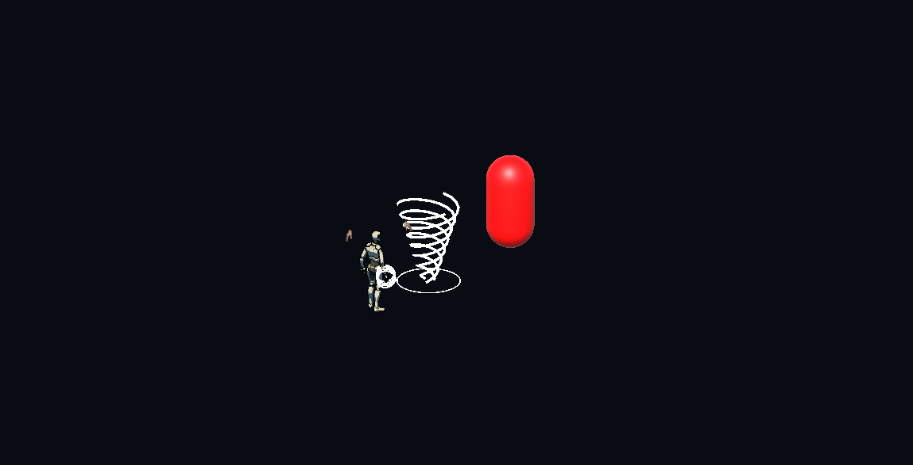

# GPR-01.2b — Punhos Titânicos: tornado de vento móvel

28/10/2026 · **Revisão de A; STOP antes de GPR-01.3.** Validação final descrita abaixo; aceite físico do novo tornado pendente.

## Escopo e feedback humano

O desenvolvedor testou a GPR-01.2 e aceitou sua funcionalidade técnica, mas considerou o gameplay pouco transformador. A onda instantânea anterior não foi aprovada como design final. Esta entrega atende à [autorização direta](AUTORIZACAO_GPR_01_2B_20261028.md): tornado lento, progressivo e emitido também após terminal em whiff. O [relatório original](GPR-01.2_RELATORIO.md) e seus artefatos permanecem históricos, sem reescrever a experiência anterior.

Não implementados grants de Conductor/Detonation, troca modular, nova skill, alteração dos ataques/Asura, nem GPR-01.3. Controles, navegação, animações, cadência, janelas de cancelamento e dano nativo permanecem sob os executores existentes. O trabalho é uma extensão do ProtocolRuntime e do contato básico atual.

## Preparação e estado inicial

AGENTS.md e canônicos lidos; skills locais e instaladas efetivamente consultadas. Projeto confirmado novamente no MCP real: `D:/Dev/Personal/My_games/Tech-Guy`, Unity **6000.5.10f1**, instância `Tech-Guy@fccafb2b47cd7671`. O cwd antigo do chat não foi utilizado para editar. Branch `gameplayOverhaul`, HEAD inicial `37fa43fca5b09115c46704ccd6f01ddadb089360`; alterações anteriores não commitadas preservadas, inclusive o CSV recovery-normal já modificado. [Git inicial](../validation/artifacts/gameplay-rework/gpr-01-2b/git-initial.txt), [hashes iniciais](../validation/artifacts/gameplay-rework/gpr-01-2b/baseline-hashes.json).

NexusBlockout inicialmente limpa em Edit Mode; nenhuma sessão humana ativa observada. MCP via HTTP local existente, sem simular Editor. A sessão HTTP antiga retornou404 na retomada; reinicializada a sessão cliente e reconfirmado o projeto. Durante EditMode houve desconexão e timeout do plugin; o Editor recuperou a resposta sem ser encerrado. Resultados só contabilizados após retorno do job completo.

## Emissão e impacto: contratos distintos

Na aceitação do terminal, o snapshot existente confirma A/BasicFinisher e captura o pacote elegível. Somente o callback de contato real de ActionImpactScheduler, depois do batch nativo de HP/notificações/feedback, chama `CommitTitanicTerminalContact`. Não se usa clique, evento cosmético, pedido de ataque ou overlap para conceder emissão. Cancelamento antes desse contato não emite; cancelamento legítimo da recovery dentro de uma notificação após contato preserva a emissão já comprometida, desde que owner/arma/contexto continuem válidos.

`ReserveTitanicTerminalEmission` reserva filho específico na **mesma raiz**, usando a quota compartilhada de filho básico. A marca de contato é estreita: owner, execução, Basic/Direct, snapshot de A, terminal e dano finito. `ReserveConfirmedBasicChild` e seu requisito de receipt positivo **não foram relaxados**. A reserva do projétil não cria HP, estatísticas, energia, mana ou raiz. A raiz retida encerra quando o soco e o futuro terminam.

Cada passo resolve overlap inicial e capsule sweep contínuo, escolhe primeiro a distância do sólido bloqueador e só depois considera vítimas antes dele. Há LOS entre origem e spawn offset para não saltar uma parede fina, e LOS de segmento para o alvo. Triggers de hurtbox são elegíveis; sólidos sem Actor bloqueiam. Saturação dos arrays/negação de query encerra com segurança. Filtro de inimigo, layer, vida/atividade e membership de sessão/encontro preservado.

Impactos usam `QueueDamage`/`DrainDamage`, confirmação de HP e estatísticas existentes, produtor Technique, profundidade1, linhagem Basic/A e **RequiredReservation** revalidada em cada commit. Deduplicação por identidade+geração; vários colliders não duplicam HP. Vítimas nativas positivas do mesmo terminal continuam excluídas, preservando a regra anterior. A mesma entidade reativada com nova geração pode receber um impacto dessa geração. Nenhum túnel novo de dano nem criação de outra raiz a cada vítima.

Política da linhagem: **`ProtocolBasicEffects.None`**, inclusive com Conductor/Detonation adquiridos. Nenhum grant novo de Protocol, postura/CC, recurso ou novo tornado causado por dano do tornado. Comportamentos nativos de Protocol fora desse ramo continuam intactos.

## Dados experimentais e dano exato

| Parâmetro | Valor |
|---|---|
| ID / alvo / rank | `mutation_gauntlet_titan_fists` / Manopla Basic /1 |
| Deslocamento máximo |5,5m a partir do centro de spawn; origem de spawn avança0,75m da pose do soco |
| Velocidade / vida máxima |3,5m/s /2s escalados; normalmente alcance encerra em aproximadamente1,571s de movimento |
| Raio / altura |0,65m /1,8m, cápsula elevada0,05m do chão plano |
| Dano |0,60 × pacote não crítico capturado na aceitação do terminal |
| Direção |Forward comprometido no contato; independente da rotação/mouse posterior |
| Gates |Uma emissão por terminal; budgets,32 impactos e caps existentes; sem aumentar limites |

O pacote é `Stats.CaptureAttackDamage(weapon.attackDamage, 1, 0, momentum.Modifier, momentum.BatchMultiplier(rank)).Amount`, com o mesmo tratamento elegível de Momentum do caminho de dano existente. Captura stats e Momentum presentes **na aceitação**; não usa HP efetivo, alvo, receipt inexistente ou maior receipt. Não chama `RollAttackDamage` e não sorteia crítico novo. O fator0,60 é aplicado uma vez ao criar o trabalho; a fila recebe o valor já resolvido e não reaplica modificadores do atacante. A vítima ainda aplica sua mitigação/imunidade. O básico nativo conserva suas regras de crítico e timing. Uma alteração posterior em Stats não muda o projétil aceito.

Todos os novos valores estão em TitanicFistsDefinition, sem tuning de dano/velocidade/dash/cadência nativos. A antiga constante GeometryMultiplier permanece sem uso; não participa do tornado. Valores são hipóteses de protótipo, não aprovação de balanceamento.

## Lifecycle e apresentação

O tornado tem posição própria, avança a cada delta escalado e congela com pausa/hitstop. Não acompanha o transform do jogador após lançar. Troca de arma, revogação de contexto/sessão/encontro, morte/disable, fim de run e cena cancelam futuros. Terminação libera token de filho e lease visual. Vida própria finita evita raiz retida indefinidamente.

Sobrepeça angular/âmbar substituída por cuff de vento e vórtice claro de quatro LineRenderers, com espirais animadas pela idade escalada. Pool limitado pelo limite existente de raízes, geração de lease evita que cleanup antigo desative instância reutilizada. Objetos do projétil são world-space, sem collider/Rigidbody; apresentação não causa dano. OnDisable limpa e OnDestroy destrói objetos/material próprios. Não há mudança permanente de prefab, rig ou cena.

Aquisição continua no catálogo/ticket existentes com mesmo ID/rank/política. O teste de oferta legítima usa rota de fixture, seed0/node5, sem grant da Mutation e com resolução única. Testes mecânicos/visuais isolados usam aquisição assistida explícita; não representam frequência de oferta nem run física completa.

## Testes e evidências

| Seleção / evidência | Resultado real | Job |
|---|---|---|
| Red contra onda anterior |0/3, todos falharam pelo contrato novo ausente |4efbf72871cf4f7985742c5e34af3303 |
| Primeiros3 após implementação |3/3,4,340654s |0e70fd1fdec04e4087cb1119d7a90fe9 |
| Mecânica/catálogo/aquisição inicial |24/24,33,5163689s |434de621d83b4af48004c4a6d5df17ca |
| Captura independente |1/1,2,6244889s |bc2eff1080244693bec03d8868e8e7fa |
| EditMode grafo/catálogos/seed |90/90,114,6857402s |4b30bf2757f3424eb46e2d268dd40f82 |
| Focados finais, incluindo fixture do binding |29/29,41,7569338s;28 casos da Mutation e1 interação |a0ca7eec1c9f48668c0bcf4601e6b9ed |
| Regressão ampliada final |187/187,90,7447516s |02090688af2f415ea00dbd3b27cb386f |

**305 nomes distintos finais aprovados, zero ignorados**, com1 sobreposição (teste de interação) entre focados e regressão. Não é a suíte global. [Contagem verificável](../validation/artifacts/gameplay-rework/gpr-01-2b/test-summary.json). Zero ignorados nas seleções concluídas acima. [Focados finais](../validation/artifacts/gameplay-rework/gpr-01-2b/focused-final-pass.json), [EditMode](../validation/artifacts/gameplay-rework/gpr-01-2b/edit-final.json), [cenários reproduzíveis](../validation/artifacts/gameplay-rework/gpr-01-2b/REPRODUCAO.md). As tentativas intermediárias não são somadas ao total final.

O teste visual usa comandos automatizados pela API real de ataque; não é entrada física nem aprovação humana. Capturas são ScreenCapture do Game View real, sem edição. Câmera/luz/alvo vermelho e montagem do rig pertencem à fixture; cenário isolado, sem alterar a arena de produção. A câmera facilita observar o corredor, mas não certifica legibilidade sob todos os telegraphs de uma batalha real.

Sequência: [equipado](../validation/artifacts/gameplay-rework/gpr-01-2b/tornado-equipped.png), [emissão após whiff](../validation/artifacts/gameplay-rework/gpr-01-2b/tornado-emitted.png), [trajeto A](../validation/artifacts/gameplay-rework/gpr-01-2b/tornado-travel-a.png), [trajeto B](../validation/artifacts/gameplay-rework/gpr-01-2b/tornado-travel-b.png), [HP posterior](../validation/artifacts/gameplay-rework/gpr-01-2b/tornado-impact.png), [limpeza](../validation/artifacts/gameplay-rework/gpr-01-2b/tornado-cleanup.png). Posição/tempo/HP/raízes em [travel.csv](../validation/artifacts/gameplay-rework/gpr-01-2b/travel.csv). PNG confirma aparência/posição; HP é comprovado pelo teste/CSV, não por inferência da cápsula vermelha.

## Regressões, limitações e desempenho

A regressão inicial falhou **186/187**, especificamente `GPRSafetyContextualRHasOneOwnerAndCannotFallThroughOnClose`, linha594: painel não abriu ao pressionar G. Reproduzida isoladamente **0/1**. Diagnóstico direto encontrou binding atual de interação **F**; a fixture presumiu G fixo. Corrigida somente a fixture de entrada: injeta binding configurado (teclado ou mouse) e mantém asserções, tempos e tolerâncias; sem gravar/restaurar preferências à força nem alterar a produção. Não confundir essa correção demonstrada com os casos históricos intermitentes de burn/hitstop/recovery, cujos clocks/asserções não foram alterados.

Os três testes iniciais do novo contrato falharam contra a onda antiga, antes da implementação; evidência red3/3 falhos preservada. Nova semântica substitui os testes incompatíveis de onda/HP nativo, sem `Ignore` ou alteração retroativa dos resultados históricos. Texto integral dos fontes anteriores em previous-sources.json, além dos resultados originais da fase anterior.

Duas queries NonAlloc por projétil/passo, arrays e lista reutilizados; LOS ainda usa `Physics.RaycastAll` e pode alocar. Pool evita Instantiate/Destroy a cada emissão após aquecer, mas o primeiro uso cria GameObjects/LineRenderers/material e cada trabalho ainda aloca um objeto. Quatro ribbons de48 pontos são atualizados por frame visual. O teste de4FPS confirma sweep/distância, não um benchmark de carga. Não foi medido orçamento de CPU/GPU/GC em8/32/64 inimigos: desempenho/legibilidade em swarms e rampas, ambiente complexo e aspecto final seguem para playtest/perfil. A trajetória é reta no plano comprometido, sem homing ou adaptação ao relevo; piso inclinado pode bloquear a cápsula, sem atravessar sólidos. Não foi solicitado transformar isso em projétil que segue NavMesh.

Os cenários automatizados cobrem contratos e fixtures reais, não uma run humana completa. Acabamento artístico, percepção de alcance, impacto e sensação transformadora continuam pendentes. O levantamento de seeds e a composição com novos grants ficam fora desta fase.

## Arquivos e skills aplicadas

Fontes de produção revisados nesta atividade:

- Characters/Player/Actions/CharControlScript.BasicImpact.cs: captura não crítica e contato que autoriza emissão.
- Characters/Combat/Protocols/ProtocolBudget.cs e ProtocolRuntime.Scope.cs: contrato estreito e reserva na raiz existente.
- Characters/Combat/Protocols/ProtocolRuntime.TitanicFists.cs: deslocamento, sweep, LOS, caps, damage queue e cleanup.
- Core/Run/TitanicFistsDefinition.cs: descrição, geometria/tempo e capability Projectile.
- Effects/TitanicFistsVisual.cs: cuff/vórtice/pool reversível.

Caminhos acima relativos a `Assets/_Project/Scripts`. TitanicFistsPlayModeTests.cs atualizado preservando os três testes de aquisição/catálogo aplicáveis; TitanicTornadoPlayModeTests.cs e meta novos. DirectMovementIntegrationPlayModeTests.cs teve apenas correção da fixture do binding configurado, preservando as mudanças anteriores. Novo cliente Tools/GameplayObservation/gpr_01_2b_mcp.py e evidências isoladas em gpr-01-2b. Atualizados requisitos, design técnico, tasks, fatia, matriz, progresso e avisos de estado; este relatório e autorização arquivada são novos. Demais alterações vistas no Git pertencem à entrega anterior e foram preservadas.

Skills locais realmente lidas/aplicadas: **tech-guy-game-vision** (transformação expressiva coerente com a identidade), **tech-guy-combat-unity** (contato/compromisso/cancel/GI), **tech-guy-boon-design** (ID/capabilities/recompensa/root/grants) e **tech-guy-unity-acceptance** (prova real versus aceite físico), em `.agents/skills/`.

Coleção instalada: **router**, **unity-csharp-scripting**, **unity-scriptableobjects**, **game-feel**, **unity-mcp-orchestrator** reutilizadas das leituras desta conversa; **unity-physics** carregada nesta revisão para sweep/colisões. ExemplosUnity6.3 adaptados ao Editor6000.5.10f1 real, sem atualizar packages. **computer-use** carregada apenas para diagnosticar janela sem resposta; não houve playtest físico por essa ferramenta. Nenhuma skill de outro engine foi apresentada como aplicada; nenhuma skill nova foi instalada. Skills genéricas não substituem os contratos locais. Nenhuma delegação/subagente usado.

## Integridade e encerramento

Inventário inicial de2459 arquivos: **2451 iguais, 8 fontes intencionalmente alterados, zero ausentes**. Nenhuma cena, prefab, asset, meta/configuração preexistente ou evidência histórica mudou em relação ao início desta atividade. 89 artefatos do experimentoGPR-01.2 incluídos nessa comparação e preservados. O CSV recovery-normal que já estava modificado também mantém seu hash inicial; não foi restaurado deHEAD. Novo fonte de teste e meta importados; zero GUID duplicado em Assets/_Project. [Integridade](../validation/artifacts/gameplay-rework/gpr-01-2b/integrity-final.json), [preservação histórica](../validation/artifacts/gameplay-rework/gpr-01-2b/historical-preservation.json), [GUIDs](../validation/artifacts/gameplay-rework/gpr-01-2b/guid-scan.json).

Editor final: NexusBlockout limpa/Edit Mode, compilação sem falhas, zero missing scripts, zero dispositivosGPR/Titanic e zero objetos de pool do tornado remanescentes. Tag temporáriaSessionState removida. Console nativa `GetCountsByType`: **0 erros,526 avisos,429 logs**, sem Clear manual. Avisos amostrados de fixtures com câmera/dash/click/Animator ausentes e keys legadas, sem confundir com assets publicados. `read_console` classificou como Exception um Debug.Log de ChargedShot; divergência do plugin preservada, não erro confirmado no contador nativo. Os erros de compilação intermediários foram corrigidos e continuam registrados em artefato, sem esconder a tentativa. [Estado final](../validation/artifacts/gameplay-rework/gpr-01-2b/editor-final.json), [filtro error do plugin](../validation/artifacts/gameplay-rework/gpr-01-2b/console-error.json), [avisos](../validation/artifacts/gameplay-rework/gpr-01-2b/console-warning.json).

Os três casos intermitentes históricos de burn/hitstop/recovery passaram na bateria atual, inclusive `MovementDuringRecoveryKeepsTheCast_UsesLatestValidOrderOnce`. Nenhuma causa temporal histórica foi demonstrada corrigida por esta entrega; não se declara encerrada a pendência apenas por esses PASS.

O runtime novo não escreve PlayerPrefs, save ou progresso persistente. Fixtures existentes restauram chaves sob seu escopo; o bindingF encontrado foi preservado. Não houve baseline independente universal de todos os saves/PlayerPrefs nem teste de save/resume da run; isso permanece uma limitação explícita.

## Recomendação e próximo gate

Recomendo **revisão física da GPR-01.2b pelo desenvolvedor**, verificando whiff terminal, direção travada, leitura do vento, corredor, parede, pausas e retorno após troca. Não declarar final o design só por ter passado testes técnicos. GPR-01.3 só deve começar após essa avaliação e nova autorização: investigar tornado→Conductor com quota/linhagem própria, sem ativar Detonation ou relaxar política global. Nada dessa composição foi implementado agora.

## Salvamento Git solicitado no encerramento

Após o pedido adicional do desenvolvedor nesta conversa, o encerramento inclui commit e push de **todas as alterações presentes**, inclusive a entrega01.2 anterior e o CSV preexistente, não apenas os arquivos desta revisão. O hash e a confirmação remota são informados na resposta final. Desligamento somente após confirmar o push. Não há início de01.3 ou alteração de escopo por esse salvamento.
