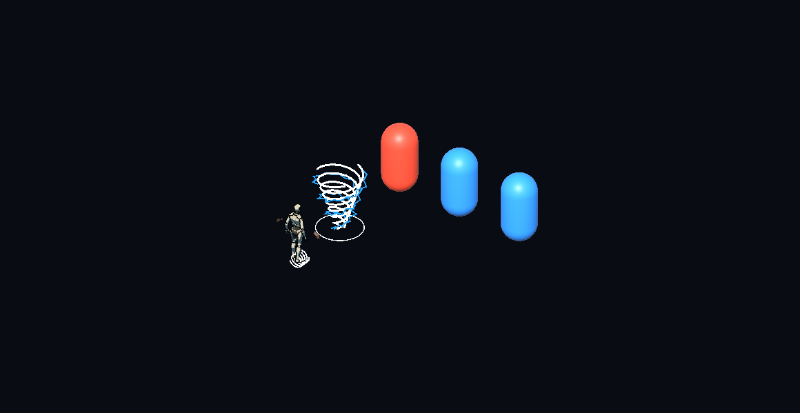
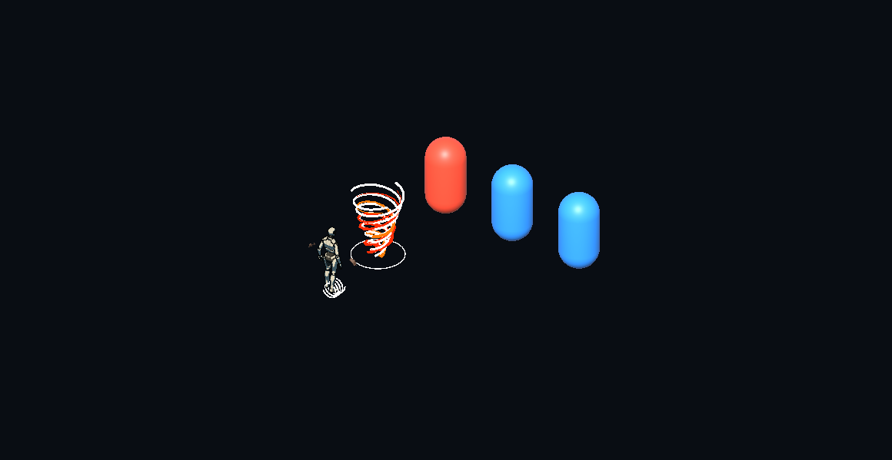

# GPR-01.4 — Punhos Titânicos + Conductor + Detonation

29/10/2026 · **IMPLEMENTADA; VALIDAÇÃO INTEGRADA COM RESSALVA LEGADA. STOP após GPR-01.4.**

O pedido direto aceita fisicamente01.2c/01.3 e autoriza01.4a–e sequencialmente. As composições mecânicas e visuais obrigatórias foram implementadas. Nova aparência precisa de revisão física do desenvolvedor. Nenhuma01.5, Singularity, atração, launch, especial novo, skill replacement, tuning ou redesign foi executada.

## Entregas e gates

| Atividade | Resultado antes da seguinte | Relatório |
|---|---|---|
|01.4a |8/8, condução nativa e derivada independentes |[Produtores](GPR-01.4a_RELATORIO.md) |
|01.4b |6/6, vento letal autoriza Detonation |[Vento + explosão](GPR-01.4b_RELATORIO.md) |
|01.4c |7/7, morte elétrica autoriza Detonation e quatro ordens |[Composição tripla](GPR-01.4c_RELATORIO.md) |
|01.4d |12/12 finais + inspeção Game View; falhas anteriores preservadas |[Visual modular](GPR-01.4d_RELATORIO.md) |
|01.4e |98/98 focados,90/90 EditMode; regressão199/203 e diagnóstico4/4, ressalva abaixo |[Integração e auditoria](GPR-01.4e_RELATORIO.md) |

## Matriz mecânica e visual final

A=Titanic Fists/Punhos Titânicos, B=Conductor, C=Detonation. IDs originais: mutation_gauntlet_titan_fists/conductor/detonation.

| Build | Mecânica | Aparência do tornado |
|---|---|---|
| Base | Básicos existentes, sem derivados novos | Nenhum tornado |
| A | Vento viajante, mesmo pacote0,60× e geometria | Vento branco, sem camada elemental |
| B | Conductor nativo preservado | Nenhum tornado |
| C | Detonation nativa preservada | Nenhum tornado |
| A+B | Primeiro impacto elegível de vento pode conduzir uma vez | Vento + relâmpagos azuis persistentes |
| A+C | Morte confirmada por vento pode detonar uma vez | Vento + fitas de fogo alaranjadas |
| B+C | Composição nativa existente, sem whitelist global nova | Nenhum tornado |
| A+B+C | Vento→Conductor; morte por vento ou Conductor autorizado→Detonation | Vento, fogo e eletricidade simultâneos |

Fogo de identidade não causa burn/DoT; eletricidade de identidade não dispara dano periódico ou arcos externos. Sobreposição visual/spawn/whiff/imunidade não autoriza efeitos. Feedback de arco real exige HP elétrico confirmado; explosão exige morte válida e orçamento. Velocidade3,5m/s, alcance5,5m, TTL2s, raio0,65m, altura1,8m, offset0,75m e dano original preservados, assim como WASD/mira/LMB/QER/RMB/Bow/Spear/dash.

## Comparação Game View real

Capturas do Unity1160×600, mesma câmera ortográfica5,5m/rig publicado/três alvos; quadros separados antes de eventos. Sem composição de pixels ou geração de imagem. Esta fixture não representa playtest físico ou certificação sob todos os telegraphs.

**A — vento puro**

**A+B — tempestade elétrica durante a viagem**

**A+C — tornado de fogo**

**A+B+C — três camadas reconhecíveis**

Eventos separados: [arcoAB confirmado](../validation/artifacts/gameplay-rework/gpr-01-4/gameview/20261029-235620-0049383/AB-confirmed-event.png), [explosãoAC confirmada](../validation/artifacts/gameplay-rework/gpr-01-4/gameview/20261029-235620-0049383/AC-confirmed-event.png), [morte elétricaABC + explosão](../validation/artifacts/gameplay-rework/gpr-01-4/gameview/20261029-235620-0049383/ABC-confirmed-event.png), [poolABC reutilizado como vento puro](../validation/artifacts/gameplay-rework/gpr-01-4/gameview/20261029-235620-0049383/ABC-reused-as-pure-wind.png). Pastas conservam travel-1/2, after-event e cleanup.

Cena de produção FirstSector e câmera de gameplay: [tornado elemental cosmético após clear](../validation/artifacts/gameplay-rework/gpr-01-4/regression/room-captures/20261029-235631-7094095/post-clear-cosmetic-no-root.png), [combate na próxima sala](../validation/artifacts/gameplay-rework/gpr-01-4/regression/room-captures/20261029-235634-0349578/next-room-combat-resumed.png). Alvo com barra na sala concluída é fixture de membership antigo; permaneceu1000HP. Ouro vem das mortes assistidas anteriores, não do tornado cosmético.

## Linhagem, ownership e dedupe

Soco e vento podem produzir suas próprias conduções no mesmo terminal. Na prova:20HP nativos +9/4,05HP de cascata nativa +12HP de vento +5,4HP de Conductor derivado =50,45HP, cinco transações e uma raiz terminal. A condução nativa pode consumir alvos antes da chegada do vento; isso reduz legitimamente os vizinhos ainda elegíveis. A quota derivada não suprime a nativa nem garante duas cadeias sem condições.

O ramo novo mantém raiz/parent/Basic/Titanic, budget32 e reserva revalidada em cada commit. Máximo de uma oportunidade Conductor e uma Detonation por tornado; Conductor somente de Technique; Detonation somente de morte por Technique/Conductor autorizado. Nenhuma Conductor→Conductor, Detonation→Detonation/Conductor ou tornado→tornado nessa linhagem. Native ProtocolEligibility e cascatas B+C não foram globalmente restringidos. Identidades+gerações, colliders, LOS, membership, query/queue e caps existentes preservados.

Comportamento causal novo provado: vento não letal12HP → Conductor mata outro alvo5HP → Detonation atinge terceiro por3,75HP. Com explosão matando vítima1HP:18HP efetivos totais, duas mortes creditadas e quarto alvo intacto. Com30 slots ocupados, vento e eletricidade consomem os últimos dois e não há explosão; com29, o32º paga a explosão. [Recibos com HP/kill/produtor/parents](../validation/artifacts/gameplay-rework/gpr-01-4/receipts) independem das imagens.

GauntletExecutionSnapshot guarda ownership no aceite; raiz guarda ranks. A reserva exige ownership legítimo e ranks capturados; view recebe a política da reserva. Adquirir B/C após aceitar ou durante voo não altera efeitos/aparência antigos; o próximo terminal usa a nova combinação. Remoção por fim de run/contexto limpa as manifestações. Em Completed/Traversal, identidade aceita é cosmética, com zero root/HP/recurso/arco/explosão e limpeza na transição.

TitanicFistsVisual conserva um pool e a geração de lease. Acrescenta arrays reutilizados de fogo/eletricidade; MPB/_BaseColor dá cores reais no shader existente. Não cria pipelines/executores separados, collider novo ou Instantiate/Destroy por update. Pool cria objetos no primeiro uso; cleanup limpa layers antes de reuso. Tempos ficam suspensos por pausa/hitstop existentes.

## Aquisição e validação

Tickets/draw/Choose reais: A+B seed0 eA+C seed1, rota assistida1→2→4→5→6, Mutation no5 e Protocol no6. Sem grantsA/B/C nesses dois casos. As escolhas anteriores são recompensas legítimas. As quatro ordens triplasABC/ACB/BAC/CAB usam aquisição assistida declarada para isolar mecânica. A rota normal exercitada só oferece uma oportunidade Protocol; não alteramos economia/pesos/tickets para fabricarABC natural. O modo anterior de apoioA+B permaneceTrue no Editor, sem concessão nova deC. Evidências de tickets em focused/conductor e conductor-replay dentro da pasta01.4.

**368 nomes distintos com aprovação observada nas seleções:278 PlayMode+90 EditMode.** Zero ignorados nos resultados finais; não suíte global. Esse total remove sobreposições e não converte a regressão199/203 em uma bateria inteiramente verde. [Seletores, jobs e contagem](../validation/artifacts/gameplay-rework/gpr-01-4/test-summary-complete.json), [tentativa ampliada](../validation/artifacts/gameplay-rework/gpr-01-4/regression-first.json), [diagnóstico4/4](../validation/artifacts/gameplay-rework/gpr-01-4/regression-diagnostic.json).

Ressalva: Asura cadenciada falhou uma vez ao esperar movimento pendente em recovery; passou isolada sem alteração, causa não confirmada. Não declaramos corrigido. Três outras falhas foram diretório de artefatos ausente, corrigido só na preparação. Falhas de fixture inicial de cadeia nativa, tint branco e MPB em inicializador também permanecem nos artefatos; MPB foi corrigido para Awake. Duas consultas EditMode perderam conexão, resultado90/90 recuperado completo. Não foram relaxados clocks, dano, caps, asserts ou tolerâncias.

## Desempenho e integridade

Fixture8/32/64 com dois tornados simultâneos/pool2 atingiu8/32/32 alvos. CPUProtocol p95:0,2822/0,717/1,117ms; frame p95:4,3974/6,4633/6,7704ms. Fila máxima9/33/64; em64 houve64 impactos negados no conjunto, sem elevar budget32. GC máximo535853/1838960/750447B por frame no Editor, incluindo teste/setup/pool. Esses números não isolamRaycastAll/sweep/LOS/ribbons/GPU nem provam zeroGC ou desempenho standalone. [Medição e limites detalhados](GPR-01.4e_RELATORIO.md#hp-aquisição-e-desempenho).

Projeto real confirmado pelo MCP: D:/Dev/Personal/My_games/Tech-Guy, branch gameplayOverhaul, HEAD653db8ba0874f53141c70e88227af76ba0dd07ae com mudanças anteriores preservadas. Worktree do chatf01b/HEAD67d8065 é antigo e não foi alterado. Manifesto2675 arquivos:2653 iguais,22 fontes/documentos alterados intencionalmente, zero ausentes; zero cena/prefab/asset/meta/config preexistente ou evidência histórica alterada. Zero GUID duplicado/malformed emAssets/_Project. [Auditoria](../validation/artifacts/gameplay-rework/gpr-01-4/integrity-final.json). Checker genérico falhou internamente no pacoteTripo3D entre volumes e não foi contado comoPASS.

Editor final NexusBlockout limpa/EditMode, compilação concluída,0 missing scripts e0 views/ribbons de tornado remanescentes; Console final amostrada sem entradas relevantes, semClear manual. Nenhum commit/push. Runtime novo não escreve saves/PlayerPrefs; fixtures preservam as chaves dos scopes existentes. Não houve baseline universal de todas as preferências/saves nem teste integral de save/resume.

Skills aplicadas: router, unity-csharp-scripting, unity-mcp-orchestrator; locais tech-guy-game-vision, tech-guy-combat-unity, tech-guy-boon-design e tech-guy-unity-acceptance, incluindo referências. Sem delegação. Fontes e arquivos por etapa nos cinco relatórios individuais; canônicos GPR, matriz, fatia, ledger, ADR e boons atualizados. [Autorização original preservada](../validation/artifacts/gameplay-rework/gpr-01-4/AUTORIZACAO_ORIGINAL.txt).

## Checklist físico e proposta posterior

- Reconhecer A/AB/AC/ABC somente pela aparência em movimento, com telegraphs reais visíveis.
- Soco próximo e vento em outro grupo: observar cadeias independentes quando há vizinhos elegíveis.
- Errar o soco, acertar vento; matar por vento e por eletricidade, conferindo explosão somente na morte.
- Pausar/retomar; limpar sala, trocar arma e entrar na próxima: nenhuma layer velha ou dano fantasma.
- Confirmar Q/E/R, RMBAsura, Bow/Spear e preferências preservados; anotar eventual falha de recoveryAsura.

**Recomendação:** revisar fisicamente estas camadas e decidir a pendência de Asura antes de autorizar01.5. Proposta01.5: duas runs integradas, acessibilidade real da build/recompensas, leitura causal e telegraphs, com evidência e avaliação do desenvolvedor. Sem ampliar automaticamente para Singularity, tuning, skills ou redesign. **GPR-01.5 não executada. STOP.**
