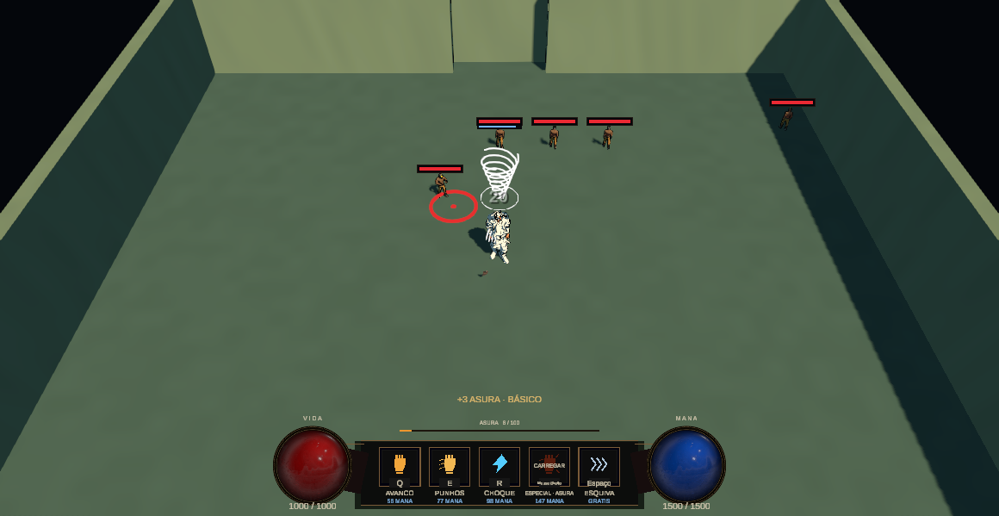
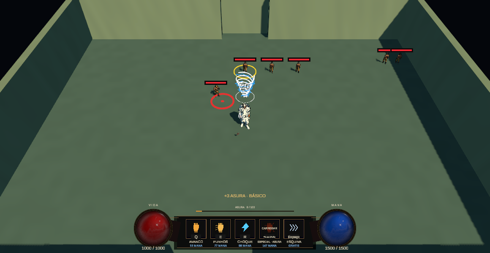
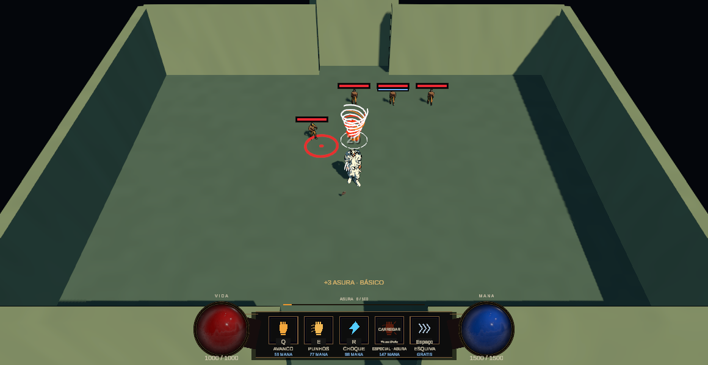
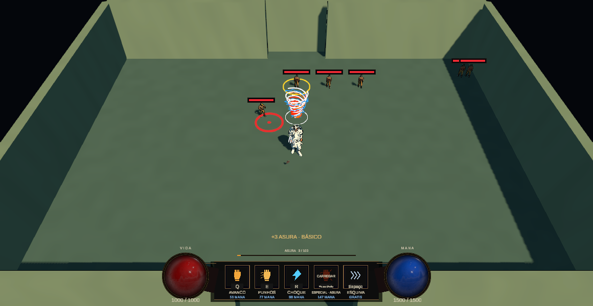

# GPR-01.5 — auditoria integrada, recompensas, leitura e estabilidade

29/10/2026 · **AUDITORIA CONCLUÍDA COM RESSALVA. NÃO RECOMENDADO ENCERRAR GPR-01 COMO TOTALMENTE ACEITA. STOP após01.5.**

A+B+C é acessível nas rotas atuais de produção sem grants de boons. Mecânica e identidade visual foram revalidadas, inclusive na câmera normal com inimigos e telegraphs. A regressão ampliada final continua **203/204** por uma ocorrência de pausa/recovery sem causa confirmada. O teste passou isoladamente, o que não encerra o risco temporal.

O desenvolvedor aceitou01.4 como implementada e demonstrada no foco documentado; **não aceitou fisicamente fogo/eletricidade novos ou a composição tripla**. Gameplay01.3 já tinha aceite anterior. Automação desta auditoria não acrescenta aceite humano. Os199/203 históricos de01.4 e4/4 isolados continuam descritos como tais, sem conversão retroativa para203/203.

## Entregas

| Subatividade | Resultado e limite | Relatório |
|---|---|---|
|01.5a |Oito builds/lineage/recursos/lifecycle:98/98 focados |[Comportamento integrado](GPR-01.5a_RELATORIO.md) |
|01.5b |768 cenários de tickets e quatro percursos publicados;ABC acessível |[Acessibilidade](GPR-01.5b_RELATORIO.md) |
|01.5c |Câmera normal, quatro identidades, feedback e telegraphs reais; humano pendente |[Leitura visual](GPR-01.5c_RELATORIO.md) |
|01.5d |Correções só de fixture; regressão203/204, pausa ainda aberta; carga8/32/64 |[Estabilidade e desempenho](GPR-01.5d_RELATORIO.md) |

Não mudou nenhuma fonte/asset de produção em01.5. Não foram alterados boons, dano, geometria, velocidade, cadência, timers, TTL, buffers, controles, pesos/frequência/tickets, salas, encontros, animação, especiais ou inimigos. Nenhuma01.6, Singularity, atração, launch, novaMutation, skill replacement ou redesign foi iniciada.

## Build integrada

Base, B, C eB+C mantêm execução nativa sem tornado. A conserva vento; A+B adiciona eletricidade persistente e condução por impacto; A+C adiciona fogo e Detonation por morte; A+B+C combina as três camadas e permitevento→Conductor letal→Detonation. Identidade não causa burn/DoT/arcos/explosões por si só.

Soco e vento continuam produzindo cadeias independentes na mesma raiz quando há vizinhos ainda elegíveis e orçamento:50,45HP no comparador exato, cinco transações. Native Conductor pode legitimamente consumir um vizinho antes do vento; isso não autoriza duplicar alvo ou renovar budget. Uma oportunidade Conductor e uma Detonation no ramoTitanic, sem recursão derivada; comportamento nativo fora dele preservado.

HP/kill/analytics por receipt e parent foram conferidos, assim como cap32/último slot, LOS/membership, colliders/gerações, cancel/reentrância, whiff/imunidade/danozero, snapshots, pool, pausa/hitstop, disable/morte/run/swap/cena/clear/próximo encontro. Grants de fixtures de combate ficam explicitamente separados de aquisição por tickets.

## Acesso natural: a limitação anterior era da fixture

FirstSector publicada usa _randomizeRooms=1. O gerador atual fornece umaMutation e várias oportunidadesProtocol. A rota de fixture exercitada em01.4 não era prova de toda a economia publicada. Assistência de EditorA+B estavaTrue e foi desligada/restaurada apenas no scope dos novos testes; snapshot de produção confirmou ausência da assistência.

| Evidência | Método | ResultadoABC |
|---|---|---|
|ModeloB-first |64 seeds×4 caminhos, prioriza A/B/C ausentes entre cards reais |253/256 (98,83%) |
|ModeloC-first |Mesma amostra, prioridadeC antesB |252/256 (98,44%) |
|Modelo de escolha uniforme |Escolha aleatória entre cards sorteados, pesos das ofertas intactos |42/256 (16,41%) |
|Quatro rotas publicadas |FirstSector, vitórias/warp automatizados, tickets/Choose/extração reais; sem grants de boons |4/4,ABC no nó5 |
|Playtest humano natural |Não executado nesta atividade |Pendente |

UmaMutation por caminho; Protocols2–4/3–6/2–5/4–7 nos caminhos0/1/2/3 da amostra. Os percursos publicados observaram3/6/4/5Protocols e chegaram ao boss/extração→Nexus. Run_Seeds completos, cards e ordens em [relatório01.5b](GPR-01.5b_RELATORIO.md#quatro-percursos-na-cena-publicada) e artefatos. Nenhuma repetição até conseguir a build: os quatro resultados são os quatro casos planejados.

As frequências do modelo pressupõem vitórias e caminhos igualmente estratificados; não medem sobrevivência, duração, preferência humana ou probabilidade universal. A priorização informada é decisiva: uniform-choice obteveA91/256 eABC42/256, apesar da oferta deA em todas as Mutations da amostra. Parte das composições chega só no nó9, com pouco conteúdo restante. Isso merece revisão de descoberta/qualidade/timing, não prova um bloqueio que justifique rework automático.

**Recomendação de economia:** nenhuma mudança é necessária agora para tornarABC alcançável. Uma auditoria futura pode comparar descoberta espontânea vs escolhas informadas, clareza dos cards, ranks repetidos e tempo de uso após montar a build. Opções de alterar pesos/frequência/gates ficam apenas como decisões futuras, após dados humanos e autorização.

## Leitura na câmera normal

Game View real1160×600 da FirstSector, câmera/HUD publicados e vários inimigos gerados. A fixture posicionou atores e conduziu EnemyCombatActions.HeavySlam para observar o telegraph real. Autonomia de decisão foi suspensa nesses comparadores; boons adquiridos por grants declarados para isolar as quatro imagens. Isso não representa batalha humana livre.

| A | A+B |
|---|---|
| | |

| A+C | A+B+C |
|---|---|
| | |

O vermelho da ameaça continua visível nos quadros inspecionados. Espiral branca, laranja e azul são separáveis; azul fino perde contraste onde cruza o vento, sobretudo em escala pequena. Não se conclui ausência universal de oclusão/overload. Sem redesign automático.

[ABC no evento confirmado](../validation/artifacts/gameplay-rework/gpr-01-5/c/20261030-003740-3275685/build-3-confirmed-event.png): receipt separado comprova12HPTechnique→1HPConductor letal→0,75HPDetonation, total13,75, três transações Basic/Titanic/parent único e um kill creditado. O alvo solicitado abaixo de1HP foi normalizado peloActor: o relatório usa HP efetivo. TextosASURA-BÁSICO no HUD vêm dos dois básicos diretos anteriores, não do vento.

Capturas temporais de viagem/evento/cleanup, [recibos](../validation/artifacts/gameplay-rework/gpr-01-5/c/20261030-003740-3275685/build-3-hp-lineage.json), snapshot após aquisição durante voo e reutilização sem layer antiga estão em01.5c/final-checks. SalaCompleted mantém identidade cosmética aceita com zero root/dano/arco/explosão; próxima sala volta ao combate, comprovado também pelos testes de lifecycle.

## Estabilidade: correções e pendência

Os três writers legados agora criam o diretório antes de salvar. O filtro5/5 começou com destino realmente inexistente, sem depender de mkdir externo. Asserts de gameplay preservados.

Asura: histórico mostra ocorrência do mesmo método já emC01.3b, antes de01.4. Probe novo reproduziu `waiting=True; progress=1; oldHelperAdmits=True; movementAllowed=True; pending=False`. A espera móvel ainda reportaRecovery; o helper antigo a admitia e o teste exigia buffer, embora o movimento fosse legitimamente imediato. O helper do caso passou a exigir recovery estacionária, sem alterar o callback/asserts/threshold/tempos do jogo. Caso original passou no filtro corrigido e na seleção ampliada final. Essa prova demonstra uma vulnerabilidade da fixture, sem identificar retrospectivamente toda ocorrência antiga.

**Pendência atual:** PauseDiscardsRecoveryMovementAndDoesNotReplayOnResume falhou em BasicAttackR1MovementFluidityTests.cs:112, esperandoIsCasting=True após0,4s reais pausado. Não há trace suficiente para separar condição temporal da fixture, efeito de ambiente ou produção. O mesmo teste passou isolado, sem mudança, no filtro final10/10. Nenhum código/TTL/recovery/buffer foi ajustado para escondê-lo;203/204 permanece o resultado da bateria. Recomenda-se diagnóstico específico da fronteira pausa/recovery antes de encerrarGPR-01.

## Testes e medições observados

Todos pelo Unity Test Framework/MCP real. [Requisições exatas](../validation/artifacts/gameplay-rework/gpr-01-5/test-requests.json) e [resumo auditável](../validation/artifacts/gameplay-rework/gpr-01-5/test-summary.json).

| Seleção | Resultado | Job |
|---|---|---|
|IntegradoTitanic/fundação/Protocols/lifecycle/rewards |98/98 |52409195165a4379ad5bce80fd673203 |
|Modelo de recompensas,768 cenários internos |3/3 UTF |4d0a0e488c724ca9a466e12a0485de32 |
|Produção:quatro rotas+quatro visuais |8/8 |0bb3da4bc2504e4c8d7a5ba93e3436bb |
|ProbeAsura antes da correção do helper |1/1 |e39daaeb0dc64dda992af435a8762e0b |
|Ambiente corrigido+Asura |5/5 |06fe1522a3f5409c98c1ab09b8c75586 |
|Regressão ampliada final |**203/204** |56c2a29c44d5439886a104eb349abb06 |
|Snapshot/pool/visual/carga e diagnóstico de pausa |10/10 |40bd953aa78d4a91a955d62b76c0ca40 |
|EditMode compatibilidade/ofertas/seeds/Asura |90/90 |8c62271c2a964aa596f571b2a7da472e |

Zero ignorados.380 nomes distintos tiveram aprovação observada na união das seleções; há sobreposições e o diagnóstico isolado de pausa não corrige a execução ampliada. Nenhuma alegação de suíte global ou aceite humano.

Medição final8/32/64, dois tornados simultâneos/pool2: atingidos8/32/32; filas9/32/64; em64 houve64 impactos negados no conjunto, mantendo cap32. CPUProtocol p95:0,2082/0,4703/0,7176ms; frame p95:3,5390/4,3583/4,6958ms; GC máximo422909/664432/648803B por frame. OverheadEditor/testes/setup/pool incluído; não é perfilrelease/standalone,CPUvsGPU ou custo isolado deRaycastAll/LOS/ribbons. Nada foi otimizado sem autorização; alocações existentes permanecem. Detalhes em01.5d/receipts.

## Integridade e arquivos

Projeto confirmadoD:/Dev/Personal/My_games/Tech-Guy, Unity6000.5.10f1, instânciaTech-Guy@fccafb2b47cd7671, branchgameplayOverhaul, HEAD653db8ba0874f53141c70e88227af76ba0dd07ae com trabalho anterior preservado. Nenhum commit/push/reset.

Baseline2819 arquivos:2805 iguais,14 fontes de teste/documentos alterados intencionalmente, zero ausentes. **Zero fonte de produção, cena, prefab, asset, meta ou configuração preexistente alterada; zero evidência histórica emDocs sobrescrita.** Zero GUID duplicado/malformed emAssets/_Project. [Auditoria](../validation/artifacts/gameplay-rework/gpr-01-5/integrity-final.json).

Novos testes: Gpr015RewardAccessibilityTests.cs, Gpr015ProductionAuditTests.cs, Gpr015AsuraStabilityTests.cs e GameplayTestEvidence.cs, com metas importadas. Alterados BasicAttackR1MovementFluidityTests.cs, DirectBasicInputPlayModeTests.cs, DirectMovementIntegrationPlayModeTests.cs e dois helpersTitanic para roteamento de evidência. Canônicos de requisitos/desenho/tarefas/validação/fatia/ledger/matriz/boons/estado atualizados. Relatórios e artefatos novos somente em01.5.

Das36 chaves registradas,32 ficaram iguais; as quatro diferentes pertencem à sessãoUnity/Connect ePT_Run do pacote de testes de desempenho. Valores comparados de preferências/progressão do jogo, loadout, moeda e resumo permaneceram iguais. Só TestResults.xml, entre5 arquivos do diretório persistente, mudou como saída operacional do UTF; o XML anterior não foi recuperado. Isso não é save/resume completo nem dump universal de toda persistência. AssistênciaTrue e destinosSessionState restaurados. [Comparação de preferências](../validation/artifacts/gameplay-rework/gpr-01-5/prefs-comparison.json).

NexusBlockout terminou limpa/EditMode, compilação concluída,0 missing scripts e0 ribbons de tornado remanescentes. Console conservou aviso de websocketMCP, semClear. Checker genérico foi executado e falhou novamente ao resolver pacoteTripo3D entre volumesC:/D:, comexit1 registrado; não certificouAssets inteiro nem motivou editar terceiros. Auditoria focal/importação não substitui esse checker global.

Skills aplicadas: quatro locais de visão/combate/boons/aceite, router, unity-csharp-scripting, unity-mcp-orchestrator e performance-optimization. Sem delegação. [Autorização original](../validation/artifacts/gameplay-rework/gpr-01-5/AUTORIZACAO_ORIGINAL.txt) preservada.

## Decisão recomendada e próximo aceite

**Não encerrarGPR-01 ainda como totalmente estável/aceita.** A disponibilidade deABC deixou de ser um bloqueio no recorte atual. Restam a ocorrência temporal de pausa e o aceite físico das camadas/tripla. Antes de01.6, recomenda-se somente diagnóstico estreito com telemetria de frames/estado de cast na fronteira de pausa, seguido dos filtros pertinentes e revisão humana. Não propomos retuning para contornar o teste.

Checklist físico curto:

- Para avaliar acesso natural, conferir se o modo temporárioTesteTornado+Conductor está desligado nessa run; a sessão original foi preservadaTrue.
- MontarA/B/C por cards e perceber a diferença das quatro aparências durante viagem.
- Confirmar soco e vento conduzindo em alvos elegíveis; observar morte elétrica seguida de explosão.
- Ler o telegraph inimigo sobABC e testar pausa no fim da recovery, retomada, clear e próxima sala.
- Conferir que Q/E/R/RMBAsura, Bow/Spear, recursos e preferências continuam corretos; reportar sensação separadamente dos números.

Proposta futura, **sem execução**: auditoria dedicada de oportunidades/qualidade das recompensas e descoberta de sinergias; layouts/pacing e tempo para usar a build; diversidade visual/papéis dos inimigos; legibilidade/encounters deElite/Boss. Comparar observação humana e dados antes de escolher qualquer mudança.

Backlog preservado, sem implementação: tornado pequeno/rápido/difícil de mirar, básicos rápidos, moonwalk, recompensas/ritmo, salas, meshes/arquetipos, elites/bosses eSingularity desejada com núcleo gravitacional/atração/dano limitado/colapso/launch/follow-up. Novos boons, especiais, economia, skills, inimigos e salas exigem autorização própria.

**STOP após GPR-01.5. GPR-01.6 e toda expansão permanecem não iniciadas.**
