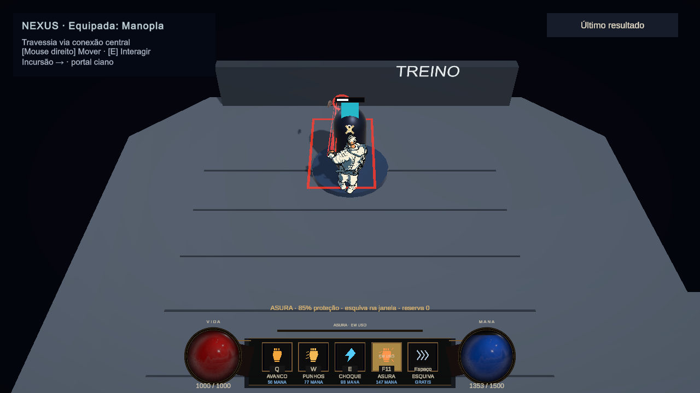

# Tech Guy — C01.1: baseline e prontidão para migração

26/10/2026, America/Sao_Paulo. **C01.1a/b executadas; STOP antes de C01.2.** GPR-00 está aprovada como auditoria/documentação com ajustes. A fase GPR-C01 completa e GPR-01 não foram aprovadas nem implementadas.

## Resultado e documentos

- [C01.1a — relatório](GPR-C01.1a_RELATORIO.md): ambiente, baseline técnica/virtual e capturas atuais, testes e preservação.
- [C01.1b — relatório](GPR-C01.1b_RELATORIO.md): desenho revisado e gates de implementação.
- [Baseline com doze áreas de cobertura](../gameplay/GPR_C01_BASELINE.md).
- [Design vigente de controles](../gameplay/GPR_CONTROL_MIGRATION.md), [ADR-0006 revisada](ADR-0006-GPR-DIRECAO-E-GATES.md), requisitos/design/tarefas/validação e ledger atualizados.

O pedido colado é a autorização atual. A [validação independente](VALIDACAO_GPR00_TECH_GUY_20261026.md) é uma revisão de documentos, não execução Unity. Textos antigos de RMB terminal, Asura em X e fatores1,25×/0,8× foram marcados como superados, sem reescrever os resultados históricos.

## O que está aprovado

| Decisão | Limite |
|---|---|
| WASD direto e mira independente no cursor | Referência câmera/mundo e motor ainda dependem de prova/decisão |
| Um clique LMB pede um ataque individual | Cliques avançam sequência; cadência/busy/contato/cancel existentes preservados. Hold automático não aprovado como padrão final |
| RMB aciona especial da arma; Asura na Manopla | Não é outro básico, quinto slot ou substituto de Q/E/R/X; reaproveitar executor real |
| Quatro slots modulares Q/E/R/X | Binding físico separado do ID; conteúdo inicial de X após separar Asura ainda pendente |
| Space para dash; Esc mantido; F contextual provisório | Direção de dash, Interact e auxiliares ainda exigem decisão |
| Rebind por ações com persistência/conflitos/reset/labels e UI segura | Input Actions+facade e piloto são desenho recomendado; nenhum backend novo aplicado |
| Preservar GI/recursos/Asura/boons/dano/RunSummary e três armas | Nenhuma autorização de tuning, kit novo, mapa ou reescrita de combate |

## Baseline demonstrada e limites

Projeto D:/Dev/Personal/My_games/Tech-Guy, Unity6000.5.10f1, branch gameplayOverhaul/HEAD3a3f0ee + alterações locais, mesmo Editor conectado. O worktree anterior de C: continua separado. NexusBlockout estava e terminou limpa em Edit Mode. Sem run humana ativa no Editor no início; não se inferiu estado de outros processos.

**Testes atuais, em filtros separados:** 21/21 PlayMode de cursor/movimento/Asura, 15/15 EditMode de identidade/bindings e **4/4 PASS Bow/Spear** no job d825ebde8d0943a09f3243c69e11fdd0. Total de 40 casos em três filtros, não uma suíte global nem testes dos controles novos. Warnings de fixtures registrados, sem limpar Console; falhas históricas Mutation/BurnTick continuam sem nova reprodução.

**Gameplay observado:** controles legados por teclado/mouse virtuais, sem novos bindings. Movimento Mouse1 e LMB no chão, tap, hold legado, dash, Q/W/E, indisponibilidade de Asura durante Busy, geração natural até100 no dummy e ativação F11 posterior, custo147/energia100→0. Navegação antiga medida por API em~5m/s planar cardinal/diagonal; Agent.Move futuro não testado. Não usar velocidade3D em desnível ou agent.velocity do dash para concluir bônus diagonal/tuning.

**Visual/UI:** cinco capturas current válidas para comandos/UI e uma tentativa ambiental descartada para input; oito PNGs selecionados realmente abertos e copiados com hashes. HUD mostra Q/W/E/F11 e Asura EM USO, medidor e custos. Resultados exibem o Store histórico real e bloqueiam pedido de básico no probe API; Controls foi aberto como draft sem Apply/Save. Não houve sessão física humana, novo aceite de feel, benchmark ou demonstração hostil com três armas. A Cadenciada/early finish foi validada em fixtures, sem inventar aquisição natural no Nexus.

Todos os manifests de captura registram restauração bem-sucedida. A primeira tentativa não gerou input pelo filtro do diagnóstico e não foi aceita como prova de comandos. Diagnósticos temporários foram compilados em memória com CodeDom, fora de Assets; não instalaram input/motor permanente. Recursos não foram injetados no treino real. A medição de cadência de parede tem overhead/interrupções, não redefine perfil.

## Decisões que faltam

| Tema | Recomendação concreta | Alternativa/efeito |
|---|---|---|
| Asura separada / X inicial (D15) | Adapter no mesmo holder, uma referência/estado/cooldown, identidade R legada; quatro slots modulares, X inicialmente vazio | Aguardar uma quarta skill aprovada. Não inventar kit nem mapear X e RMB para a mesma Asura |
| Hold e Bow ChargedShot (D16) | Padrão clique sem repeats; discutir modo legado opt-in com tratamento explícito da carga | Redesenhar press/release da carga só por aprovação; não desabilitar boon ou habilitar hold automaticamente |
| RMB Bow/Spear (D17) | Projetar especial próprio após auditoria de capacidades | Não usar alias de básico nem roubar skill R/órbita/carga; transição indisponível requer aceite explícito |
| Motor e referência (D12) | Provar Agent.Move em fixture isolada; câmera relativa como candidato | Se falhar, reabrir motor único/CharacterController; não acumular controladores |
| Dash (D18) | Manter inicialmente direção de mira para reduzir mudança, comparar fisicamente | WASD ativo com fallback mira/facing exige aceitação própria |
| Interact/compacto (D13) | Ação separada, tecla ainda não escolhida; inspeção compacta por UI/ação própria | G evita conflito com F, mas não foi aprovado. F interação exige remapear finalização por decisão |
| Migração/rebind (D14) | Pilotar cópias de prefs/overrides em memória/EditMode, preview com conflitos e consentimento | F11 é Skill4 global entre armas; não migrar silenciosamente para dois owners ou escrever metade do esquema |

O maior risco estrutural é concreto: Asura usa index3/Array.IndexOf e identidade R em snapshot/continuação/boons/analytics. Trocar tecla isoladamente não a torna independente. O design propõe separar a visão modular do owner do especial sem mudar dano/executor; ainda precisa implementação e testes específicos depois do gate. Aprovação de GPR-00 não aprovou as políticas de swap/cooldown/investimento ou a fatia A+Conductor+Uppercut.

## Próxima etapa proposta: C01.2a

Escopo a autorizar: protótipo isolado de movimento direto sobre a geometria existente, com vetor normalizado, um motor, cantos/paredes/bordas/desníveis/avoidance, root/commit/dash/pull, pausa/hitstop/foco e análise da fonte de velocidade para animação. Não salvar cenas, alterar mapa/balanceamento ou ligar o motor ao player publicado nessa primeira prova. Confrontar com a baseline e testar fisicamente o candidato antes de integrar. Se não satisfizer colisão/feel, registrar falha e rever o motor; sem forçar NavMeshAgent por ter sido hipótese do planejamento.

C01.2b/2c são integração posterior ao gate do protótipo; C01.3 exige D15–18/compatibilidade; C01.4 exige piloto e migração aprovados. Todos continuam sem autorização neste fechamento. Primeiro passo proposto, portanto: **autorizar somente C01.2a como protótipo isolado**, mantendo o player atual intacto até revisão.

## Preservação, arquivos e estado

Arquivos de gameplay, tuning, assets, GUIDs/.meta, pacotes, moeda, loadout, unlocks, tutorial, bindings e RunSummary não foram modificados como produto. Foram adicionados documentação/evidência e quatro scripts de diagnóstico .cs.txt fora de Assets, invocáveis explicitamente e sem listeners remanescentes. O manifesto final registra todos os arquivos novos/modificados e hashes. Fonte original de visão e relatórios anteriores preservados.

A comparação final confirmou 1778 arquivos preexistentes idênticos, 546 exclusões totais (510 fora de Docs/36 em Docs) iguais às listas anteriores, prefs/summary consultados iguais e zero dispositivos C01 remanescentes. Editor NexusBlockout limpa/Edit Mode e consulta de erros vazia; warnings de fixtures preservados. QA verificou 19 documentos do pacote sem links locais ausentes. [QA final](../validation/artifacts/gameplay-rework/c01-baseline/qa-final.json) / [manifesto exato de arquivos e hashes](../validation/artifacts/gameplay-rework/c01-baseline/manifesto-arquivos.json). Essa cobertura não equivale a comparar todo arquivo binário de terceiros ou toda preferência do sistema. Rollback do trabalho é somente documentos/evidências/diagnósticos novos, sem resetar checkout ou progresso humano.

**Status:** GPR-00 concluída documentalmente/aprovada com ajustes; C01.1a concluída tecnicamente; C01.1b concluída como design e aguardando aprovação; fase GPR-C01 parcial. **STOP aplicado. A implementação do movimento e dos novos inputs não começou.**
