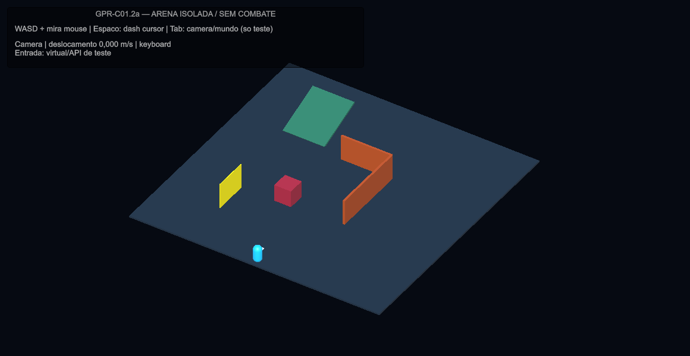
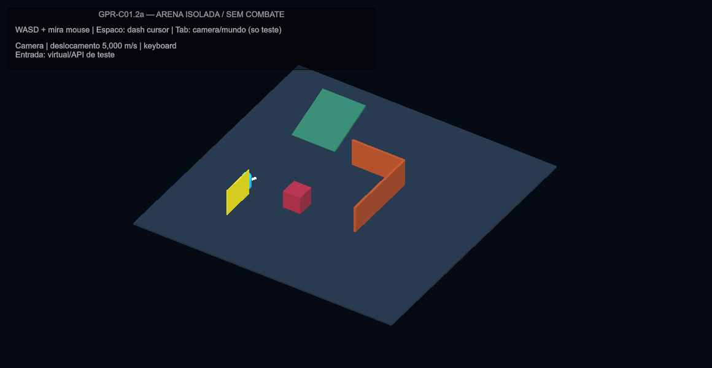
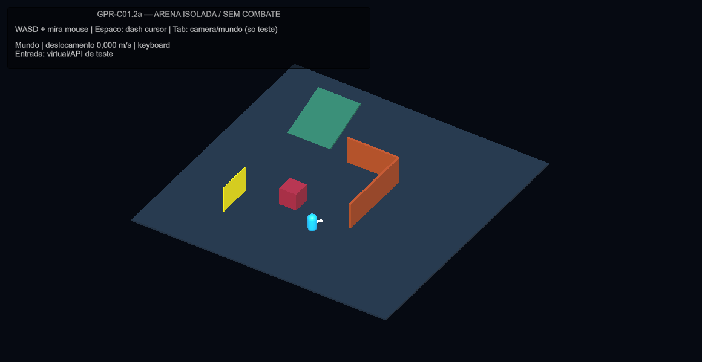

# Tech Guy — GPR-C01.2a: protótipo isolado de movimento WASD

Atividade da fase GPR-C01. Execução iniciada em 26/10/2026 e encerrada em 27/10/2026, America/Sao_Paulo.

**Status: CONCLUÍDA como experimento técnico isolado; AGUARDANDO REVISÃO DO DESENVOLVEDOR.** Não há aprovação humana de controles/feel, integração ao player nem autorização para C01.2b/c, C01.3–5 ou GPR-01.

## Resultado e recomendação

Rejeitar **NavMeshAgent.Move sem proteção física**: o teste reproduziu travessia de parede sólida ausente do bake. Manter **NavMeshAgent.Move com varredura de cápsula e limite por NavMesh raycast** como candidato técnico para a próxima revisão, condicionado aos limites abaixo. Não adotar em produção por este relatório. Não há motivo demonstrado para migrar agora para CharacterController: ele bloqueou a parede, mas sozinho saiu do limite navegável e exigiria assumir altura/gravidade/limites e todos os escritores de deslocamento existentes.

O protótipo normaliza diagonais, separa deslocamento e mira, não usa destinos de clique e mede locomoção pelo deslocamento final. Os testes novos e regressões selecionadas terminaram **59/59 PASS em quatro jobs finais**. Isso não é suíte global nem playtest físico. O experimento cobre uma arena sintética; navegação dos mapas publicados e animação do personagem real continuam sem integração.

## Autorização, preparação e baseline

O desenvolvedor aceitou C01.1a/b no escopo técnico/documental e autorizou exclusivamente C01.2a. Decisões de extração da Asura, X inicial e especiais RMB Bow/Spear permanecem abertas e **não bloquearam este experimento**. Dash por WASD foi somente comparação; o candidato padrão da fixture continua cursor fixado no início, como o legado.

Foram lidos AGENTS.md, instruções aplicáveis, canônicos de controle/requisitos/design/tasks/ownership/validação, ADR-0006, baseline C01.1 e fontes de visão/plano. A visão orienta produto; o plano é roteiro; nenhum texto desses amplia a autorização direta recebida. Não foram alterados os documentos originais de visão e plano.

Projeto real: `D:/Dev/Personal/My_games/Tech-Guy`, instância MCP `Tech-Guy@fccafb2b47cd7671`, **Unity 6000.5.10f1**. O checkout indicado no chat (`C:/Users/gabri/.codex/worktrees/b720/Tech-Guy`, Unity 6000.3.3f1) não é a instância em execução e não recebeu o protótipo. Branch `gameplayOverhaul`, HEAD `3a3f0ee8ad82734104511b63877d38df512ea146`, com alterações humanas preexistentes; nenhuma limpeza/reset/commit foi feita. Estado completo em [git inicial](../validation/artifacts/gameplay-rework/c01-2a/git-status-inicial.txt). Inicialmente NexusBlockout salva/limpa, Edit Mode, sem sessão de gameplay ativa no Editor; isso não atesta outros aplicativos do computador.

Baseline autorada preservada: agente speed=5, acceleration=99999, radius=0,5, angularSpeed=0, stoppingDistance=0; Dash.asset=20 m/s por 0,25 s, reconferido no Editor. Não houve ajuste de valores para favorecer o novo motor. Prefabs, cenas, executores, configurações, bindings e saves existentes permaneceram inalterados nos hashes verificados.

## Skills encontradas, carregadas e aplicadas

| Origem | Skills lidas/aplicadas | Aplicação concreta |
|---|---|---|
| Repositório `.agents/skills` | `tech-guy-game-vision`, `tech-guy-combat-unity`, `tech-guy-boon-design`, `tech-guy-unity-acceptance`, com referências aplicáveis | Identidade/câmera; preservar compromissos, cancelamentos e causalidade; impedir extração prematura de Asura/mutações; testes MCP, integridade e distinção humano/virtual |
| Coleção instalada em `C:/Users/gabri/.codex/skills` | `router`, `unity-csharp-scripting`, `unity-input-system`, `input-systems`, `unity-navmesh` | Roteamento Unity, assembly restrita a testes, leitura de dispositivos somente na fixture, normalização, soltura, agente único e limites navegáveis |
| Mesma coleção | `unity-animation`, `game-feel`, `unity-physics`, `physics-tuning` | Parâmetro de animação por deslocamento, velocidade/timing sem tuning, varredura de cápsula, avaliação do CharacterController e passos temporais explícitos |
| Instalada em `unity-mcp-skill/SKILL.md` | `unity-mcp-orchestrator` | Instância/projeto reais, reflexão de API, importação, Console, Test Runner, Play Mode e restauração |

As skills Unity genéricas miram 6.3 LTS; foram adaptadas ao Editor **6000.5.10f1**, sem downgrade/upgrade. Move, CapsuleCastNonAlloc e BuildNavMeshData foram conferidos por reflexão MCP; Input System 1.20.0 e navegação existente foram preservados. Skills de mapas/mundos não foram aplicadas a um experimento de controle. Não se usou uma suposta skill Unity de testes não encontrada: a aceitação customizada e Unity Test Framework orientaram a validação. O checker Python recomendado pela skill C# **falhou por incompatibilidade entre volumes C: e D:** ao resolver o pacote Tripo3D; não foi apresentado como aprovado nem alterado para esconder o erro. Ver [diagnóstico](../validation/artifacts/gameplay-rework/c01-2a/metadados.json).

## Implementação e arquivos

Tudo que executa o protótipo está em `Assets/_Project/Scripts/Tests/GprMovementPrototype/`, assembly `TechGuy.Tests.GprMovement`, condicionada a `UNITY_INCLUDE_TESTS`, sem referência adicionada à assembly de gameplay:

| Arquivo criado | Responsabilidade |
|---|---|
| `GprMovementMotor.cs` | Direção câmera/mundo, mira plana, árbitro experimental de movimento, dash comparativo, sweep/raycast, velocidade real e parâmetro Animator |
| `GprMovementArena.cs` | Geometria/NavMesh/material/Animator temporários, câmera/luz e overlay de proveniência; teardown remove os dados |
| `GprMovementPreview.cs` | Menu de preview em cena vazia **não salva**, recusa jogo ativo/cena suja/múltiplas cenas; restaura a cena anterior ao sair de Play Mode |
| `GprMovementTests.cs` | Dez testes comportamentais PlayMode, CSVs e quatro PNGs da Game View |
| `TechGuy.Tests.GprMovement.asmdef` e cinco `.meta` | Isolamento e GUIDs importados pelo Unity; há também `.meta` da nova pasta |

Criado `Tools/GameplayObservation/c01_2a_analyze.py` para resumo dos CSVs, integridade e GUIDs; apenas lê fontes, escreve evidência. Criados este relatório e evidências em `Docs/validation/artifacts/gameplay-rework/c01-2a/`. Atualizados ledger, matriz, ADR-0006 e pacote de requisitos/design/tasks/validação/migração/README. Lista integral e hashes dos artefatos em `manifesto.json` na pasta de evidência. Uma entrada IDE gerada para a nova assembly em Tech-Guy.slnx foi removida seletivamente, preservando o delta humano preexistente.

### Ownership e suspensão

- Movimento só chama **Agent.Move**. Warp é usado exclusivamente no posicionamento inicial de cenários de teste, nunca para atravessar obstáculo durante movimento. Não há SetDestination nem escrita de transform.position no motor; a rotação é separada. Initialize recusa coexistência com CharControlScript, Rigidbody ou CharacterController no mesmo objeto. Não há PlayerActor, AbilityHolder, dano, recurso ou save na arena.
- Ordem experimental: pausa/foco → hitstop → deslocamento forçado → dash → root de ataque/cast → teclado. Pull/knockback são fornecidos como velocidade externa ao mesmo escritor. Pausa/hitstop suspendem o relógio do dash; foco perdido/disable cancelam o dash da fixture. Pausa/foco exigem soltura antes de retomar WASD. O protótipo não interpreta pedidos de combate nem concede i-frames.
- Os gates são **sinais sintéticos de teste**, não adaptações já integradas aos executores. C01.2b deverá mapear os estados reais e preservar savedStopped/savedRotation, cancel resolver, clocks e imunidades existentes. Movimento permitido durante cast usa ausência de root; o árbitro real de facing/commit ainda depende da integração aprovada.
- Agent.velocity ficou **zero** nos cenários Move, embora o corpo percorresse ~5 m/s. LateUpdate/amostragem pós-movimento calcula deslocamento planar/dt, direção e `Animator.ActualPlanarSpeed`. O teste confere o parâmetro num Animator temporário. Não foram alterados controller, blend tree ou animações do personagem publicado; strafing/facing/contato no rig real ainda precisam validação.
- Não há projeção automática tangencial para “escorregar” ao longo de paredes. Um vetor diagonal contra a parede pode parar integralmente; movimento paralelo e saída do canto foram exercitados. É um limite explícito de feel a revisar, não compensado por velocidade maior.

## Testes executados e resultados exatos

| Execução MCP | Resultado | Evidência |
|---|---|---|
| Primeira consulta antes do force refresh `dc042a54e856472daf9ce4426e82a794` | **0 casos**, não conta como validação | AssetDatabase ainda não importara os arquivos novos; refresh if_dirty não bastou |
| Protótipo inicial `d9bdf34afc724d1d9c803f19f1b10f15` | 7 PASS / 1 FAIL | Resíduo float de dash bloqueava segundo BeginDash; teste preservado, motor corrigido para encerrar resíduo <0,00001 s |
| Após correção + alternativa CC `f59b285acdc247479bea25715a4ca07a` | 9/9 PASS, 2,6944295 s | Iteração intermediária arquivada |
| Parâmetro Animator `a86f331e31054d7c82ae909b5a6cd4dc` | 9/9 PASS, 2,7633817 s | Iteração antes do teste adicional de dt zero; `testes-prototipo-9-parametro.json` |
| **Protótipo final** `13ca6c65d3114119b5347044bf22e09f` | **10/10 PASS**, 2,7685889 s | `testes-prototipo-final.json` |
| **Legado/GI/Asura** `66c52554cb4640a6ab03ebea21280dbc` | **26/26 PASS**, 22,15014 s | 21 filtros do baseline + cinco de contato/cancel/causa/cadência/hitstop; `testes-regressao-26.json` |
| **Dash cancel/imunidade** `149ce43f84fc4383941881425886db4a` | **8/8 PASS**, 1,6541381 s | Pipeline existente, cooldown, buffer, i-frames/cleanup; `testes-dash-8.json` |
| **EditMode Asura/controles** `bfd1eb5b51b34d26a07574905b96d8af` | **15/15 PASS**, 0,0581934 s | `testes-editmode-15.json` |

Os dez novos testes cobrem: cardinal/diagonal/parada/mira; câmera versus mundo e passos 1/30, 1/60, 1/144 s; parede/canto/escape/obstáculo/borda; parede fora do bake e dash; CharacterController alternativo; roots/cast/hitstop/pull/pausa/foco/disable; dash cursor versus WASD/relógio congelado; rampa de 20° subindo/descendo; teclado/mouse virtuais pelo mesmo leitor usado no preview; pausa com dt zero e passos NaN/infinito/negativo. A revisão final zerou explicitamente o parâmetro de animação e exigiu soltura mesmo quando dt=0, sem publicar NaN. Os passos 30/60/144 são **dt controlados**, não alegação de medição física em monitores nessas taxas. O teste de dispositivo virtual também usa Time.deltaTime real por ~0,3 s.

Além dos testes, o menu abriu realmente uma cena vazia em Play Mode, com **um motor e zero PlayerActor**; saiu e restaurou NexusBlockout limpa. Nenhuma tecla humana foi observada ou aceita como playtest. Nenhum controlador paralelo foi colocado no player; no teste CC, motor/agente estavam desativados antes da alternativa.

## Medições e comparação com o legado

CSV bruto por teste, `medicoes-resumo.json`, `virtual-input-real-time.json` e `character-controller-assessment.json` permitem reproduzir os números.

| Cenário | Resultado observado |
|---|---|
| Cardinal candidato | 4,998779 m/s; ~4,998779 m em 60 passos de 1/60 s |
| Diagonal candidato | 4,997739 m/s; razão diagonal/cardinal ~0,999792; sem vantagem diagonal |
| Legado histórico C01.1 | Medianas planares 4,99857259 cardinal / 4,99989142 diagonal; caminho por API em Nexus, **não a mesma arena/câmera** |
| Soltura | 10 amostras com 0 m/s e nenhum deslocamento residual |
| Câmera yaw 90° | W desloca +X; em mundo W desloca +Z; ~5 m em ambos. Candidato câmera acompanha orientação visual; mundo mantém bússola estável, mas pode divergir do “para cima” da tela |
| Passo 1/144 s | 5,000977 m/s; pequeno erro de precisão de coordenadas, sem multiplicador de velocidade |
| Input System virtual em tempo real | 1,512356 m em 0,302557 s → 4,998577 m/s; W+D normalizado, soltura testada |
| Parede sem bake, Move cru | Partiu X=-11 e chegou X=-5, atravessando a parede X=-8 |
| Parede sem bake, candidato protegido | Dash bloqueado em X≈-8,56; input posterior paralelo à parede não a atravessou |
| Canto | Avanço paralelo chegou a Z≈3,74; recuo saiu ~2 m; sem travamento permanente nesses comandos |
| Rampa 20° | ~4,998779 m/s planar nos dois sentidos; altura final da subida ~1,915 m e retorno ~0,071 m; nenhum salto de posição fora do percurso testado |
| Dash aberto | Cursor +Z percorreu 5 m com direção fixa; alternativa WASD +X percorreu 5 m. Mesmo 20 m/s e 0,25 s ativo; hitstop não consumiu o restante |
| CharacterController | Parede bloqueada X≈-8,559937; saiu para Z=-18 além do piso/NavMesh. Precisa regra adicional de limite/solo; não adotado |

A variação de velocidade nos trechos retos registrados foi zero dentro da precisão CSV, sem zigue-zague posicional medido. Isso **não comprova ausência universal de jitter visual**: não houve clipe comparativo, teste de câmera dinâmica/rig nem avaliação humana. O candidato usa deslocamento horizontal; em rampa a velocidade 3D é maior pela componente vertical, como deve ficar explícito ao comparar métricas planares.

Observação de desempenho: custo mediano de Step em trechos retos ~11–15 µs, p95 nesses trechos ~14–24 µs; maior p95 por cenário registrado ~70,2 µs. São amostras de Stopwatch no Editor, com ruído de Test Runner; **excluem** parte da atualização nativa de navegação, renderização, Animator e instrumentação CSV. Não representam orçamento de frame, benchmark de build, GC global nem carga de 8/32/64 inimigos. Não houve otimização ou alteração de qualidade para melhorar o resultado.

## Evidência visual real

Quatro capturas ScreenCapture da **Unity Game View, 1160×600**, abertas e inspecionadas; não são mockups, renders externos ou aprovação física. Cores: piso azul, parede/canto laranja, obstáculo vermelho, parede fina amarela e rampa verde. Overlay identifica input virtual/API. A cápsula é um marcador experimental, não substituição do personagem.

## Console, integridade e limitações

Compilação/importação final sem erros; quatro scripts resolvidos pelo AssetDatabase para as classes esperadas. Os cinco GUIDs de arquivos novos não duplicam os 1348 metadados enumerados por rg em Assets. Essa checagem focada **não substitui o checker global incompatível**. Não foi limpo o Console para esconder achados. Houve warning preexistente de keys curtas nas fixtures AbilityHolder e um warning de reconexão WebSocket MCP entre reloads; os jobs e o preview completaram. A última consulta de erros/warnings após preview estava vazia. Detalhes dos warnings dos testes estão nos JSONs, não descartados.

**1778 arquivos preexistentes protegidos** (Assets/_Project, Packages, ProjectSettings, .agents e AGENTS.md) conservaram SHA256 e existência, preservando nesse conjunto o conteúdo humano inicial. O diff de status, com opções iguais nos dois snapshots, também detectou que o arquivo raiz não versionado `Docs.zip` constava inicialmente e não existe ao final. Nenhuma operação desta atividade leu, escreveu ou removeu esse arquivo; a origem dessa diferença não foi determinada, e ele não fazia parte do inventário de hashes. Não se declara preservação universal fora do conjunto verificado nem se tenta recriar o ZIP sem seus bytes originais. Ver `git-status-delta.json`. Bindings continuam `[323,324,32,113,119,101,292,102]`; moedas2597/loadout0/unlocks/tutorial consultados iguais. RunSummary continua com42387 caracteres e SHA256 `9751067523EABB7557FFEC504779DB853925D6665AE876DAF8C0C489D52189B3`. Final: NexusBlockout limpa/Edit Mode, zero dispositivo virtual C01, zero objeto de protótipo carregado e zero vértice do NavMesh temporário. Não se alterou save para construir a fixture.

Limitações ainda abertas:

1. Paredes móveis que nascem sobre a cápsula, plataformas móveis, escadas, rampas íngremes, OffMeshLinks, portas carved em transição e geometria de mapas reais não foram validados. Sweep não faz depenetração inicial; fora do NavMesh o motor para, sem Warp de recuperação.
2. Avoidance local foi desativado na fixture para impedir movimento autônomo; crowd/enemy blockers e custo de queries sob carga precisam cenário próprio. Buffer cheio de 32 hits falha fechado, sem teste de saturação desta atividade.
3. Vetor diagonal pressionado contra parede pode parar em vez de deslizar; direção câmera com yaw variável e fallback de câmera vertical exigem avaliação autoral. Não se afinou skin/voxel/speed para mascarar esses limites.
4. Dash protegido conserva direção/valores nominais; truncamento exato do último passo e suspensão de clocks são da fixture. Compatibilidade temporal com a corrotina real, i-frames, cancels e pulls simultâneos deve ser demonstrada no adaptador futuro. Testes legados passaram sem conectar o novo motor.
5. Gates sintéticos provam o árbitro isolado; não provam que todos os executores atuais já entregam ownership corretamente. O rig real, compromisso de rotação, blends/strafe e consumidores de agent.velocity (incluindo CurrentMoveDirection/Kiting Step) ainda precisam adaptação aprovada.
6. Nenhum playtest físico, aceitação de feel, benchmark de build ou suíte global. Não há migração de input/bindings/Settings/QERX/LMB/RMB nem decisão de conteúdo Asura/X/Bow/Spear.

## Próxima atividade proposta: C01.2b, sem execução autorizada

Após revisão deste relatório, propor integração controlada inicialmente em cópia temporária do player/cena, com um adaptador no ownership existente: encaminhar root/cast/facing/dash/pull/hitstop ao único motor aprovado, manter stats/dash/causalidade e trocar consumidores de agent.velocity por deslocamento final onde necessário. Provar cantos/portas/rampas reais e regressões GI nas três armas; testar câmera versus mundo e colher avaliação física antes de adotar o referencial final. Decidir tratamento de parede diagonal/overlap e direção de dash. Só depois do gate explícito alterar o player publicado.

Esse recorte não inclui remap/Settings, quatro slots, Asura RMB, mudança de LMB, extração de Asura, X inicial ou novo especial Bow/Spear. Decisões de conteúdo não devem bloquear a investigação do motor; integração de conteúdo e controles terá seus próprios gates. **STOP em C01.2a.**
