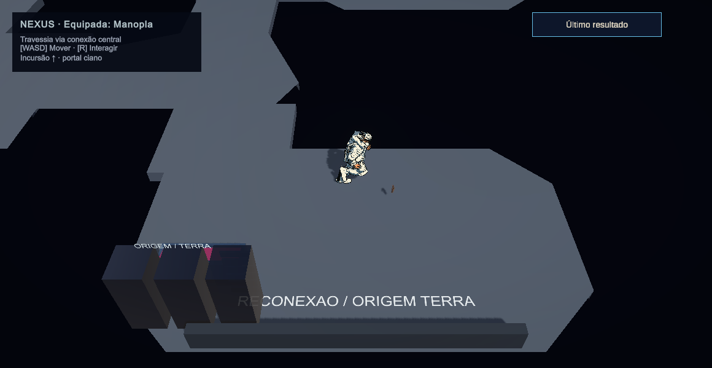
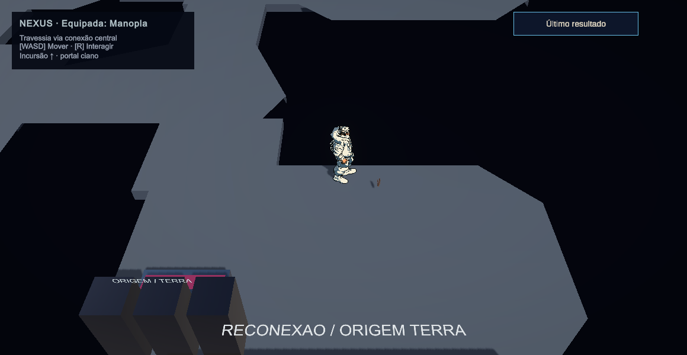

# Tech Guy — GPR-C01.2b: integração WASD e migração mínima de teclas

27/10/2026 — America/Sao_Paulo. Fase GPR-C01.

**Status: IMPLEMENTADO, COM VALIDAÇÃO TÉCNICA EXECUTADA NO ESCOPO; ACEITAÇÃO FÍSICA PENDENTE.** Motor integrado às quatro cenas jogáveis habilitadas. Não significa conclusão da migração completa de controles, Settings ou GPR-01.

## Autorização e resultado

Após revisar C01.2a, o desenvolvedor declarou “era exatamente assim que eu imaginava” e autorizou a implementação no jogo. Ao esclarecer a colisão do W com uma skill, escolheu explicitamente **incluir agora a migração das teclas das skills**. Isso autoriza C01.2b e o recorte mínimo de bindings necessário à integração; não autoriza nova arquitetura modular, conteúdo de X, extração de Asura ou alteração de LMB/RMB.

O jogador publicado agora usa **WASD relativo à câmera, diagonais normalizadas e mira independente pelo mouse**. Cliques não criam destinos nem perseguição automática. Dash continua dirigido pelo cursor. Velocidade autorada, valores de dash, perfis de ataque, impacto, dano, recursos e IDs de habilidades foram preservados.

| Ação atual | Tecla efetiva no baseline humano consultado |
|---|---|
| Movimento | W/A/S/D, fixas nesta etapa |
| Básico | Mouse0 e gesto direcional/hold legados; a revisão de LMB não foi implementada |
| Interação pelo mouse | Mouse1, sem destino de movimento |
| Dash | Space, direção do cursor |
| Três skills herdadas | Q / E / R |
| Especial herdado / Asura | F11 personalizado, preservado; não convertido em slot X nem movido para RMB |
| Finalizar / retornar projeção | F contextual, preservado |

O índice histórico3 continua sendo o especial existente. **X não ganhou conteúdo nem uma nova ação modular.** A interação contextual da Nexus continua vinculada ao token histórico Skill3, agora R no perfil migrado, com os bloqueios preexistentes; separação em ação própria segue pendente. Custos, cooldowns, boons e atribuição histórica Q/W/E/R não foram renomeados pela troca das teclas físicas.

## Preparação e ambiente real

Lidos AGENTS.md, skills locais e referências aplicáveis, canônicos de controle/design/tasks/validação, ADR-0006 e relatório C01.2a. A solicitação direta mais recente prevaleceu sobre o STOP anterior, sem alterar as fontes originais de visão/plano.

Projeto **D:/Dev/Personal/My_games/Tech-Guy**, branch `gameplayOverhaul`, HEAD `3a3f0ee8ad82734104511b63877d38df512ea146`, com alterações humanas preexistentes preservadas fora dos arquivos intencionais. O checkout C:/Users/gabri/.codex/worktrees/b720/Tech-Guy não foi usado como projeto ativo. Unity **6000.5.10f1**, instância MCP `Tech-Guy@fccafb2b47cd7671`. Inicialmente NexusBlockout em Edit Mode, sem sessão humana de gameplay ativa no Editor.

O conector MCP do desktop manteve erro de handshake. A revisão automática bloqueou o comando de início do serviço; o desenvolvedor iniciou o servidor manualmente. Saúde, versão10.3.0, ferramentas, instância e recursos foram então descobertos pelo **protocolo MCP HTTP real em localhost:8080**, usando cliente Python de diagnóstico. Compilação, testes, Play Mode, serialização e capturas ocorreram no Unity real, não em um simulador externo. Nenhuma configuração do Codex ou pacote terceiro foi alterada para contornar o problema.

A primeira tentativa de snapshot por código falhou pela API obsoleta Selection.instanceIDs de Unity6.5; o arquivo com a falha foi preservado. A persistência foi consultada com sucesso **antes da ativação nas cenas** e depois do smoke. O snapshot de Console anterior às primeiras alterações não foi obtido; não se declara Console inicial limpo por inferência. Console final e de runtime foram consultados sem executar Clear.

## Skills aplicadas e compatibilidade

| Origem | Encontradas/lidas/aplicadas | Uso |
|---|---|---|
| `.agents/skills` do repositório | tech-guy-game-vision, tech-guy-combat-unity, tech-guy-boon-design, tech-guy-unity-acceptance e referências | Escopo/identidade, compromisso/contato/cancelamento, IDs/boons/causalidade, evidência real e preservação de dados |
| Coleção instalada em C:/Users/gabri/.codex/skills | router, unity-csharp-scripting, unity-input-system, input-systems, unity-navmesh, unity-animation, game-feel, unity-physics | Controlador existente, normalização, ownership, colisão, locomoção por deslocamento, isolamento de bindings e testes |
| `unity-mcp-skill/SKILL.md` | unity-mcp-orchestrator | Discovery, recursos/instância, importação, Console, Test Runner e validação no Editor |

As skills Unity genéricas miram 6000.3; a implementação foi adaptada ao **6000.5.10f1 real**, sem migrar versões/pacotes. Não foi inventada uma skill Unity de testes ausente; a aceitação customizada orientou o Test Framework existente. O checker Python da skill C# foi executado e falhou ao resolver pacote em C: contra projeto em D: (`os.path.relpath`); não foi rotulado PASS. Ver stderr e checagem focada dos novos GUIDs.

## Implementação real

`CharControlScript` continua coordenando input, combate e locomoção. O novo partial implementa somente o caminho direto; não adiciona um segundo MonoBehaviour motor ao player. O caminho legado permanece desativado quando a flag direta está ligada, para rollback e fixtures históricas.

`PlayerNavigationMotor` é o escritor comum de deslocamento: varredura de cápsula, limite por Agent.Raycast e Agent.Move. Respeita pausa/hitstop, bloqueio de mundo, pull, dash e root/cast. **Pull tem prioridade e encerra o dash ativo.** Agente não recebe destinos de clique; sua rotação automática e avoidance autônomo são suspensos no modo direto. O árbitro consulta os estados reais existentes, sem duplicar timers de combate.

Dash, avanço da Manopla, recoil/backstep, Kiting Step e pull passam por esse escritor quando o player está no modo direto. Reação/agrupamento só entram nele se o alvo realmente for esse player; inimigos e caminhos legados continuam usando seu comportamento anterior. Spawns/transições/ragdoll recovery mantêm seus reposicionamentos deliberados, fora da locomoção contínua.

O avanço com body traversal já precisava publicar imediatamente a posição resolvida para o ImpactEvent. Essa sincronização foi mantida **dentro do escritor comum**, copiando somente Agent.nextPosition depois das restrições de colisão/NavMesh. Um teste confere contato imediato e bloqueio por parede, sem teleporte através dela.

ActualMovementVelocity e Walk/Idle vêm do deslocamento planar final, não de agent.velocity. A amostra de locomoção anterior é preservada no instante de aceitar o básico para o Kiting Step reconhecer recuo; impulsos de dash/cast não são confundidos com intenção locomotora. A amostragem foi integrada ao LateUpdate existente de BasicImpact, preservando a reaplicação da pose de contato. Rooted basic/casts mantêm seu facing; Bow conserva movimento com a redução de velocidade já definida pelo executor.

Pausa/foco/disable exigem soltura de WASD e zeram a locomoção. Dash direto congela o tempo restante de deslocamento durante hitstop; o relógio de i-frames continua independente e seu cleanup permanece no executor. Não se estendeu imunidade nem se mudou dashVelocity/dashTime.

### Migração de teclas sem regravar o perfil antigo

GamePreferences foi estendido, sem criar outro serviço de input. A leitura do perfil direto transforma Q/W/E em Q/E/R e preserva customizações válidas; conflitos com WASD/duplicatas recebem fallback determinístico. O especial legado R usa F11 como compatibilidade padrão; a preferência F11 já existente foi mantida. Enum/índices não foram reordenados.

As preferências antigas `TechGuy.Settings.Binding.*` continuam intactas. **Leitura não grava migração.** Apply no perfil direto grava o namespace versionado `DirectBinding.v2.*`, após validar o conjunto inteiro; erro não produz escrita parcial. O round-trip de teste restaura existência/valor de todas as chaves novas. Title e pausa usam a fachada existente; prompts essenciais de movimento e teclas foram atualizados. Não há InputAction asset novo, PlayerInput paralelo ou schema de RunSummary novo.

WASD ainda não tem remapeamento por componente; essas teclas ficam reservadas na captura das outras ações. Primário/secundário, migração completa de Settings, ação própria Interact e quatro slots modulares continuam nas etapas correspondentes.

## Arquivos criados/modificados

| Grupo | Arquivos |
|---|---|
| Novos, sob Scripts/Characters/Player | `PlayerNavigationMotor.cs`, `Actions/CharControlScript.DirectMovement.cs`, com `.meta` |
| Novo teste | `Scripts/Tests/PlayMode/DirectMovementIntegrationPlayModeTests.cs`, com `.meta`; assembly PlayMode existente |
| Coordenação | CharControlScript.cs, CharControlScript.BasicImpact.cs, PlayerActor.cs, GamePreferences.cs |
| Produtores de deslocamento | DashScript.cs, BreakerGauntletCombat.cs, ArsenalCombat.cs, KitingStepCoordinator.cs; gates condicionais em CombatReactionController.cs e SoftGroupingService.cs |
| UI necessária à integração | MainMenuUI.cs, PauseMenuUI.cs, ControlRemappingPanel.cs, LobbyInteraction.cs, TutorialHUD.cs |
| Builders, não executados para reconstruir mapas | LobbySceneBuilder.cs, FirstSectorBuilder.cs, TutorialSceneBuilder.cs: preservar a flag ao gerar player no futuro |
| Cenas habilitadas | PrologueTutorial, NexusLobby, FirstSector e NexusBlockout: **somente `_directKeyboardMovement: 1`**. Diff contra backup anterior verificado; campos default materializados pelo SaveScene foram removidos seletivamente |
| Diagnóstico fora de Assets | Tools/GameplayObservation/c01_2b_mcp.py, c01_2b_enable.cs.txt, c01_2b_nexus_driver.cs.txt, c01_2b_audit.py |
| Documentação | Este relatório, ledger, matriz, ADR-0006, requisitos/design/tasks/migração/validação/README; evidências c01-2b |

Backups anteriores das quatro cenas em Library/GprC01Integration/scene-backup-20261027; não substituir alterações humanas posteriores com esses backups. Metas/GUIDs existentes foram preservados. Assets de arma, balanceamento, animação, mapa/NavMesh, Packages e ProjectSettings não receberam mudanças desta atividade. Manifesto e lista exata de hashes/arquivos acompanham a evidência.

## Testes executados — resultados exatos

| Job MCP | Resultado |
|---|---|
| Integração final `dc00aa748d8a48988c64a7dca22ea13c` | **13/13 PASS**, 5,6817428s |
| Regressões finais `19d32a503db54ed68852da004c3c4c45` | **30/30 PASS**, 24,4674966s; cursor/movimento/GI/Asura/Bow/Spear |
| Dash `99692b45fad74704ae6fb209c4858993` | **8/8 PASS**, 1,7219733s; cancelamento, buffer, cooldown e i-frames |
| EditMode `2791be3cfd27430ab28ac13cdf2a2fcb` | **15/15 PASS**, 0,0792495s; contratos de finalização/controles |

**66 casos distintos finais em quatro jobs; não suíte global.** As iterações não são somadas como novos casos.

Os 13 novos casos cobrem migração pura/customização; teclado/mouse virtuais com foco virtual conhecido; cardinal/diagonal/parada/mira e W sem cast; básico com root/pose/um contato; parede sólida não baked para motor/pull/dash; perda de foco/pausa/soltura; Bow com velocidade de cast; avanço Q exclusivo; cast Spear sem locomotion writer concorrente; dash/hitstop; Kiting Step ao aceitar ataque em recuo; pull interrompendo dash; pose de contato imediato; salvar/recarregar bindings e rejeição de conflito sem escrita parcial.

Houve falhas reais de iteração, preservadas:

- Compilação inicial detectou LateUpdate já existente e uso de uma propriedade de PlayerActor num Actor genérico. A amostragem foi integrada ao callback correto e o tipo consultado foi corrigido. Erros de compilação dos testes também foram corrigidos; Console final sem erros.
- Primeiro grupo novo:5/6 PASS; caso de velocidade retornou0 no Editor em segundo plano. Preparação passou a declarar foco **virtual** e soltura de teclas explicitamente; grupos seguintes7/7,10/10,11/11 e13/13 passaram, mantendo a medição de velocidade e a prova de parada por foco perdido.
- Primeiro grupo legado:29/30 PASS. `MovementDuringRecoveryKeepsTheCast_UsesLatestValidOrderOnce` falhou na restauração do destino. Sem alterar código/tolerância, passou isolado (`9f925294b16d4a88a34e773d3e56fe0e`,1/1,0,9220123s) e no grupo final30/30. **Causa de timing/ordem não confirmada**; não se declara defeito definitivamente resolvido nem se descarta a falha. Repetir no próximo QA sob carga.

Warnings de fixture sobre keys curtas, click effect/dash não configurados e Animator mínimo aparecem nos JSONs. Não foram ocultados por Clear. A inspeção final de runtime retornou zero erros; isso não apaga as ocorrências históricas.

## Medições e evidência visual

Na fixture real de player/agente, cuja velocidade histórica de teste é8: cardinal **7,999998m/s**, diagonal **8,000003m/s**, zero casts por W. Não se alterou a fixture para fingir5m/s. Na Nexus publicada, o agente continua speed=**5**; mediana livre **4,999993m/s**, máximo **5,000063m/s**, agent.velocity=0. Soltura registrou0m/s. Isso confirma a necessidade de derivar animação do deslocamento.

Smoke real de2,5s,461 amostras: Keyboard/Mouse virtuais e SendMessage de foco virtual, zero AbilityUsed, sem injeção de recursos. O jogador partiu de X6,5/Z-6,8; o trecho livre chegou à borda em Z≈-4,011. A tentativa W+D nessa posição foi bloqueada e ficou parada. **Não é medição de diagonal livre na Nexus**; a normalização foi demonstrada na fixture. É o caso concreto de diagonal contra borda que ainda exige avaliação de feel: sem projeção tangencial automática, o vetor inteiro pode parar.

Três PNG reais da Game View **1160×600**, abertos e inspecionados. Não são mockups nem playtest físico. Mostram o personagem e a Nexus reais; nenhuma arte/rig foi refeita.

Desempenho: sweep não aloca arrays por movimento; bindings são resolvidos/cacheados por frame. CSV do Editor inclui captura/diagnóstico e não é benchmark de build ou orçamento de frame. Não foram medidos GC global nem8/32/64 inimigos; não há justificativa para tuning de velocidade, dash ou qualidade. Não se afirma ausência universal de jitter visual com capturas estáticas.

## Integridade, limitações e próximo passo

Dos **1789 arquivos protegidos iniciais**, **1767 permaneceram idênticos**,22 tiveram mudanças intencionais listadas e nenhum desapareceu. Três GUIDs novos foram conferidos sem duplicatas no inventário enumerado de Assets; checker global indisponível por erro entre volumes, com stderr preservado. Não se apresenta essa alternativa como validação global do projeto.

Persistência antes da ativação e depois do smoke é igual: moedas2597, bindings antigos `[323,324,32,113,119,101,292,102]`, RunSummary42387 caracteres e SHA256 `9751067523EABB7557FFEC504779DB853925D6665AE876DAF8C0C489D52189B3`. O runtime direto leu **Mouse0/Mouse1/Space/Q/E/R/F11/F**. Isso é perfil efetivo novo sobre dados antigos preservados, não falha da migração. Editor restaurado NexusBlockout limpa/Edit Mode; objetos/dispositivos de diagnóstico removidos.

Pendente: avaliação física humana; crowd/avoidance; overlap inicial e obstáculos móveis; escadas/plataformas/OffMeshLinks; feel de bordas/cantos; percurso real de combate nas três armas e casos adicionais de boons; investigação da falha transitória do buffer; UI/reward/results e ciclo completo de foco; remap de WASD e Settings completos. Cenas FirstSector/Prólogo/NexusLobby tiveram flag e serialização verificadas, mas não um percurso físico completo nesta atividade.

**Próxima atividade recomendada: C01.2c**, após testar fisicamente WASD no jogo: fechar os contextos de input/UI e held-release, comparar a rigidez em bordas e coletar avaliação de animação/strafe. C01.3 fica responsável por LMB/RMB, Asura especial e decisões de X/Bow/Spear; C01.4 completa remapeamento e migração de Settings. Não foi iniciado GPR-01. Não há adoção silenciosa de dash por WASD ou de Asura em X.
