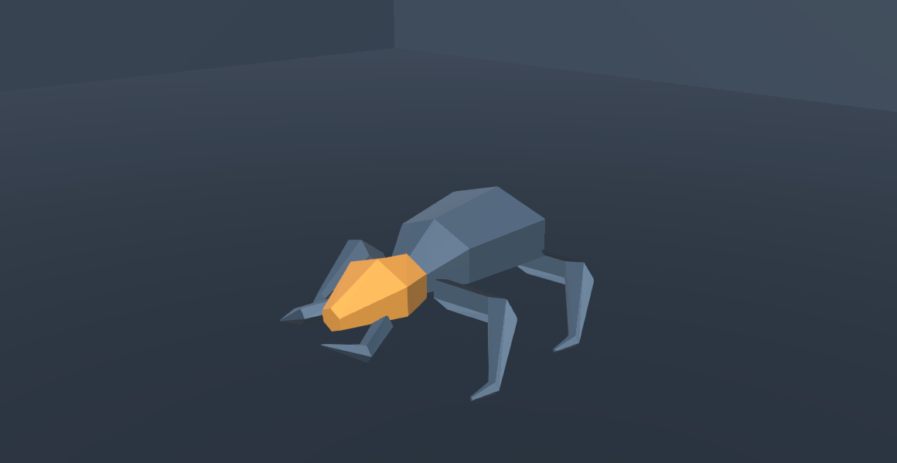
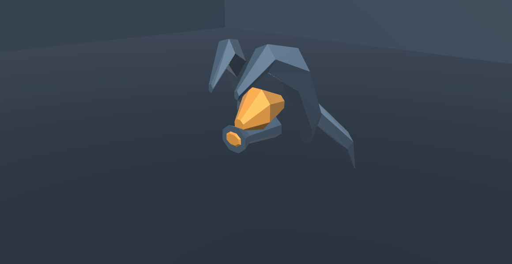

# RUN-EXP-02 — relatório consolidado

**Fatia isolada entregue para revisão técnica e física. STOP após 02.4. Gameplay, visual e arte de produção não estão aceitos.** Os inimigos, salas e cartões não substituem conteúdo publicado. Projeto real: `D:/Dev/Personal/My_games/Tech-Guy`.

## Abrir e avaliar

No Unity em Edit Mode, use **Tools → Tech Guy → RUN-EXP-02 → 1 - Abrir arena aberta**, depois Play. Botões permitem reiniciar A/B, substituir o encontro por um candidato e inspecionar recompensas sem aquisição. Saia de Play e use a opção3 para voltar ao Nexus. Controles e rebindings existentes seguem o HUD. O teste normal tem dano real.

| Atividade | Entrega e estado |
|---|---|
| [02.0 — estabilidade](RUN_EXP_02_0_STABILITY.md) | Pull/fogo preservados;13/13 focados e classificação31; três destinos de evidência corrigidos/revalidados; dívida histórica aberta |
| [02.1 — inimigos](RUN_EXP_02_1_ENEMIES.md) | Fragmento quadrúpede baixo e Emissor suspenso com carcaças/arma próprias; combate nativo; prova geométrica intermediária |
| [02.2 — arenas](RUN_EXP_02_2_ARENAS.md) | A aberta e B com massas deslocadas; mesma dupla/contagem/tuning; navegação, colisão, projétil, dash e básicos verificados |
| [02.3 — recompensas](RUN_EXP_02_3_REWARDS.md) | Consulta real em três armas, antes/depois com mesmos cards, sem Choose ou alteração de probabilidades |
| [02.4 — integração](RUN_EXP_02_4_INTEGRATION.md) | Fluxo reproduzível, testes, evidências,8/32/64 ativos, proteção e limites registrados |

## Geometria, animação e combate

Fragmento: 304 triângulos, corpo baixo segmentado, quatro membros e mandíbulas; avança rapidamente para o golpe curto. Emissor:288 triângulos, duas carcaças em torno do núcleo, quilhas e cano de emissão; abre a estrutura antes do tiro com direção comprometida. Duas materiais iguais reforçam a comparação por forma; a identidade não depende de trocar a cor. Blender não conectou. Malhas são autoradas proceduralmente no Unity, com UV simples e animação customizada; não são personagens finalizados.

Câmera normal e frames separados: [pair-start-normal-camera.png](../validation/artifacts/run-exp-02/integration/20261030-220628-8278188-7de59e16f6f845a1983b5148df31c738/pair-start-normal-camera.png), [fragmento-move.png](../validation/artifacts/run-exp-02/integration/20261030-220628-8278188-7de59e16f6f845a1983b5148df31c738/fragmento-move.png), [fragmento-windup.png](../validation/artifacts/run-exp-02/integration/20261030-220628-8278188-7de59e16f6f845a1983b5148df31c738/fragmento-windup.png), [fragmento-attack.png](../validation/artifacts/run-exp-02/integration/20261030-220628-8278188-7de59e16f6f845a1983b5148df31c738/fragmento-attack.png), [emissor-move.png](../validation/artifacts/run-exp-02/integration/20261030-220628-8278188-7de59e16f6f845a1983b5148df31c738/emissor-move.png), [emissor-windup.png](../validation/artifacts/run-exp-02/integration/20261030-220628-8278188-7de59e16f6f845a1983b5148df31c738/emissor-windup.png), [emissor-projectile.png](../validation/artifacts/run-exp-02/integration/20261030-220628-8278188-7de59e16f6f845a1983b5148df31c738/emissor-projectile.png). Rótulos/fases de fixture não provam leitura visual. Emissor começa distante; avaliar sua massa e preparação na câmera real. Arte e animação ainda exigem refinamento, contato dos pés, UV/textura/LOD e morte final.

## Espaço e escolhas

A permite circulação contínua. B interrompe linhas em x=-2,3 e exige contorno por duas rotas, com spawns ajustados ao piso. Cobertura de4,2m evita o básico de Lança atravessar a massa por alcance; não se acrescentou oclusão global aos ataques de área existentes. O caso vermelho e as ilhas de topo foram preservados e corrigidos localmente. [Arena B em combate real](../validation/artifacts/run-exp-02/captures/arena-b-gauntlet-current-1.png).

Cartas: [rewards-existing-Arco.png](../validation/artifacts/run-exp-02/integration/20261030-220628-8278188-7de59e16f6f845a1983b5148df31c738/rewards-existing-Arco.png) / [rewards-proposed-Arco.png](../validation/artifacts/run-exp-02/integration/20261030-220628-8278188-7de59e16f6f845a1983b5148df31c738/rewards-proposed-Arco.png). O catálogo admite impacto próximo, alcance, minas/posicionamento, retorno e Protocol de valor imediato. A consulta não recomenda ABC nem garante parceiros futuros. A tela mostra o que está adquirido e condiciona as possibilidades; as capturas começam sem aquisições. Contexto com build natural já adquirida não foi demonstrado fisicamente e permanece pendente.

## Regressões e testes

`b007fc8e1c3940cd8cc95cc4fd59dc00` — 13/13 PlayMode, 27.966s, 0 ignorados; `3862bb8a2c134ad59fab6fe78808319f` — 10/10 PlayMode, 56.621s, 0 ignorados; `64ba37df12cc45638fba9ea4d14ece5f` — 1/1 EditMode, 0.512s, 0 ignorados; `7eb548c0fd354f1da745694aa4ade0b2` — 11/11 PlayMode, 9.650s, 0 ignorados. Não somar: o teste de diretório aparece em seleções sobrepostas. Os31 casos históricos estão no [ledger de classificação](RUN_EXP_02_0_STABILITY.md):13 históricos,9 expectativas antigas,5 variáveis,3 preparação de evidência,1 não resolvido; zero defeitos novos de produção confirmados nessa comparação. A terceira captura com destino repetido também passou no job11/11. Não se declara a suíte353 inteiramente verde.

## Desempenho

| Inimigos ativos | CPU mediana/p95 ms | Behaviour mediana ms | Nav mediana ms | Pose mediana ms | GC mediana bytes/frame | Renderers / triângulos | Windups máx. |
|---|---|---|---|---|---|---|---|
| 8/8 | 3.094/4.613 | 0.492 | 0.057 | 0.013 | 297648 | 62 / 2400 | 5 |
| 32/32 | 4.994/6.998 | 0.668 | 0.180 | 0.049 | 501608 | 246 / 9568 | 10 |
| 64/64 | 6.986/10.245 | 0.922 | 0.277 | 0.099 | 741704 | 491 / 19120 | 22 |

Editor e instrumentação incluídos; CPU não é GPU, Behaviour não isola IA, GC não é custo puro dos modelos. Amostra5s/cenário, jogador imune, todos os8/32/64 agentes ativos. Candidatos sem skinning, duas materiais; renderers/triângulos contam somente sua geometria. [Detalhes, séries e limites](RUN_EXP_02_4_INTEGRATION.md).

## Checklist físico e decisões seguintes

- Jogar A e B com o mesmo kit, atacar/dash/usar habilidades junto aos limites e à cobertura; comparar rotas, segurança e prioridade.
- Reconhecer cada candidato sem nomes e sem depender do núcleo colorido; ler antecipação e recuperação sob VFX.
- Verificar Emissor distante, contato dos pés do Fragmento, reação, CC e clareza do despawn.
- Comparar cards das três armas; revisar a redação de efeitos atuais, escolhas imediatas e possibilidades futuras numa build natural já adquirida.
- Reavaliar pull/fogo A/AB/AC/ABC fisicamente; registrar aceite explícito ou ajustes.

Não estão prontos para produção: topologia/UV/texturas/rig/LOD/materiais finais; animação final; feel e leitura de swarm; publicação de salas; compatibilidade exaustiva de todas as áreas/Protocols com cobertura; reescrita editorial integral dos cards; performance em build/hardware alvo. Próxima fase recomendada: revisão física e decisões de direção/contrajogo, depois produção de arte/refino local autorizado. Não iniciar mais arquétipos, bosses, Singularity ou GPR01.6 automaticamente.

## Verificação, preservação e limites comuns

Instância MCP `Tech-Guy@fccafb2b47cd7671`, Unity `6000.5.10f1`, projeto real `D:/Dev/Personal/My_games/Tech-Guy`, branch `gameplayOverhaul`, HEAD inicial `314d28ec22ae2d242409fbfd10ea7f8368dd76e9`. O checkout antigo do chat não foi usado para implementar. O cliente `Tools/RunExp02/mcp_call.py` chama o Unity MCP existente, seleciona o projeto e conserva respostas; UTF, compilação, Console, prefabs e Play foram verificados no Editor. Não há servidor ou runner substituto.

Resultados integrais, sem somar execuções sobrepostas:

- Estabilidade: `b007fc8e1c3940cd8cc95cc4fd59dc00` — 13/13 PlayMode, 27.966s, 0 ignorados.
- Fatia final: `3862bb8a2c134ad59fab6fe78808319f` — 10/10 PlayMode, 56.621s, 0 ignorados.
- Geometria: `64ba37df12cc45638fba9ea4d14ece5f` — 1/1 EditMode, 0.512s, 0 ignorados.
- Contratos existentes selecionados: `7eb548c0fd354f1da745694aa4ade0b2` — 11/11 PlayMode, 9.650s, 0 ignorados.

Os nomes exatos, asserções, mensagens e saídas constam nos JSONs correspondentes em `Docs/validation/artifacts/run-exp-02/`. As fixtures usam imunidade do jogador somente nas sequências visuais/medições e testes especificados; o playtest normal não a recebe. Conclusão/death automatizada é prova mecânica, não vitória humana. O teste de obstrução dispara um projétil nativo diretamente, em fixture explícita, e não representa uma aquisição de poder.

306 arquivos protegidos com SHA-256 idêntico ao início, incluindo cenas publicadas, prefabs, definições, Resources, pacotes e configurações. `integrity-final.json` registra a comparação. As três chaves reais de PlayerPrefs — arma, resumo de run e tutorial — mantiveram existência, valor inteiro e hash do texto. Não se chamou Finish/Save das estatísticas na revisão, nem existe ProgressionDirector nela. As moedas adicionadas por Actor.Awake são removidas somente nos candidatos instanciados na revisão. As alterações anteriores em `Docs.zip`/`Docs (2).zip` foram preservadas.

Limite da auditoria de saves: o inventário inicial do registro usou separador incorreto e retornou vazio; ele não demonstra a totalidade das preferências. A comparação válida cobre as três chaves lidas por PlayerPrefs e os arquivos disponíveis, majoritariamente logs/testes/analytics. Não se alega um hash integral do perfil humano. RunSummary foi protegido pela fixture de isolamento existente. Não houve reset de preferências.

Arquivos desta frente: [manifesto](../validation/artifacts/run-exp-02/files-manifest.json), acrescido destes seis relatórios e das atualizações no ledger, matriz, masterplan, requisitos, design, tarefas e estado do projeto. Nenhum prefab publicado foi substituído e nenhum GUID histórico foi recriado. O estudo RUN-EXP-01 continua disponível. Editor final em NexusBlockout, Edit Mode, cena limpa; ver `editor-final.json`. Não houve commit/push nesta nova frente.

Gates: **técnico aprovado no recorte testado**; **gameplay e visual aguardam revisão física**; **arte de produção pendente**. Teste verde não aceita feel, leitura sem rótulos ou arte final. Não publicar candidatos/salas/UI na progressão antes dessa revisão. STOP após 02.4.

Capturas adicionais de Play via MCP, sem imunidade e com Manopla: [Arena A](../validation/artifacts/run-exp-02/captures/arena-a-gauntlet-current.png) / [Arena B](../validation/artifacts/run-exp-02/captures/arena-b-gauntlet-current-1.png). Probes `arena-a-native-combat.json` e `arena-b-native-combat.json` confirmam dano ao jogador e agentes válidos; tempos de observação diferentes, não usar HP como comparação causal de dificuldade. `combat-cover.png` da fixture termina com Arco após a checagem das três armas.

Conferência final dos arquivos do persistentDataPath: [save-files-final.json](../validation/artifacts/run-exp-02/save-files-final.json). Quatro dos cinco hashes permanecem iguais; somente TestResults.xml mudou pela execução UTF. Isso não é alteração de save de gameplay. Console final sem erros;306/306 hashes protegidos e três preferências conferidas, com os limites de cobertura já registrados.
