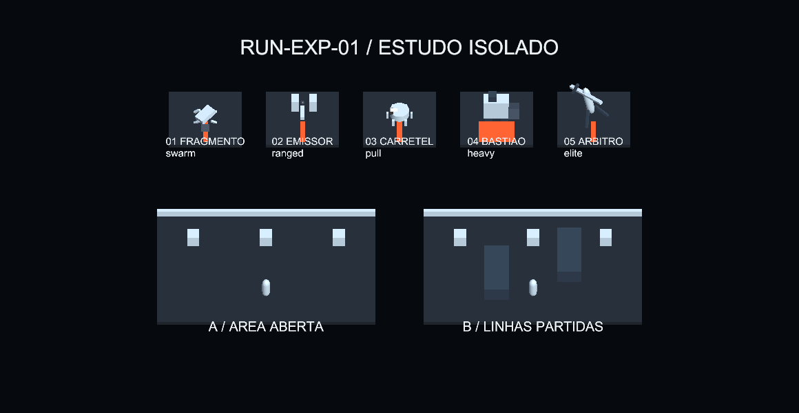

# RUN-EXP-01 — Etapa2: protótipos isolados para revisão

**30/10/2026 — estudos implementados e capturados no Unity. STOP desta frente.** São blockouts com primitivas, não arte de produção, IA nova, níveis publicados ou aceitação humana.

## Conteúdo efetivamente criado

Cena: `Assets/_Project/Prototypes/RunExperience/RunExperienceStudy.unity`, fora de EditorBuildSettings. Cinco corpos diferentes na mesma paleta neutra: Fragmento quadrúpede baixo com cunha/patas; Emissor com dois blocos suspensos/vão/cano; Carretel de disco com seis apoios e braço assimétrico; Bastião largo com pernas curtas/martelo; Árbitro alto com tripé e braço suspenso. Não reutilizam o humanoide genérico com marcadores coloridos. O esquema não certifica reconhecimento sem nome: isso permanece tarefa humana.

`RunExperienceStudyMotion` apresenta ciclos de quatro segundos, com preparação, compromisso e retorno: abaixamento do Fragmento, abertura do Emissor, armação do gancho, elevação do martelo e abertura/rotação do braço Elite. Há faixas candidatas de aviso, sem hitbox/dano. Movimento procedural é apresentação de papel, **não** rig final, locomoção com NavMesh ou executor de combate. Poses foram amostradas em0,15/0,95/1,15/2,15s; os dois instantes próximos ao compromisso permitem comparar antecipação e gesto.

Duas arenas de18×12 unidades de estudo, mesma posição relativa de player proxy/spawns: A aberta; B com dois volumes baixos desencontrados de2×1,2×5. B cria duas rotas e corta linhas; A permite leitura/prioridade em espaço livre. Bordas baixas evitam ocultação por parede alta no estudo. O proxy tem escala aproximada humana; não foi ligado ao player real. Não houve bake de navegação ou combate nesses layouts. Logo, diferenças de LOS/circulação são **hipóteses visuais**, não comprovante de pathfinding, dodge ou encontro justo.

Não foi necessário implementar UI de recompensa: o conceito de hierarquia/card está documentado na etapa1; prototipar uma economia alternativa antes da revisão não agregaria evidência ao recorte. Nenhuma nova aquisição, peso, ticket ou habilidade foi adicionada.

## Reprodução e evidência

Abrir a cena isolada no Editor. Play Mode anima os estudos automaticamente. O builder `Tools/Tech Guy/Run Experience/Build isolated study` só cria o estudo se ele ainda não existe; recusa sobrescrever a cena de revisão e não reconstrói Nexus/FirstSector. Materiais e scripts ficam na mesma árvore. Não adicionar ao build publicado.

Unity Test Runner/MCP:

- `c14ff292720847f49b0cc353bbc00eab`:1/1 aprovado na primeira captura; identificados labels sobrepostos e título cortado no enquadramento de silhuetas. Corrigidos no próprio estudo.
- `e191ce3934834e69ba91e45d49a13dbc`:1/1 aprovado após ajuste; verifica cinco estudos, ausência de Actor e cena fora do build, além de capturas. [Resultado](../validation/artifacts/run-exp-01/prototype-final-e191ce39.json).
- Capturas finais: `Docs/validation/artifacts/run-exp-01/stage2/20261030-050000/pose-0.15.png`, `pose-0.95.png`, `pose-1.15.png`, `pose-2.15.png`, `silhouettes.png`, `context.txt`.

As imagens finais são **Game View real** de1160×599, dimensões conferidas no cabeçalho PNG, sem montagem offline. Overview usa câmera ortográfica17; a comparação de silhuetas usa12 e oculta apenas as duas arenas no frame. Essa câmera de estudo não é a certificação de leitura na câmera de FirstSector. Antes da entrega, NexusBlockout/EditMode deve estar restaurada. As capturas intermediárias foram preservadas, não substituídas.

## O que o estudo permite decidir

| Pergunta de revisão | Evidência atual | Próximo gate, após autorização |
|---|---|---|
| A anatomia muda sem depender de cor? | Cinco formas próprias, mesma receita de material; quadrúpede/disco/blocos/tripé/massa pesada | Mostrar sem labels e registrar identificação pelo jogador na câmera real |
| O gesto sugere uma ameaça diferente? | Preparação e compromisso distintos nos quatro samples | Rig/clip final e execução por EnemyCombatActions, sem duplicar contato por animação |
| Geometria altera decisão espacial? | Mesmos anchors em aberta versus duas barreiras | Player/nav/LOS/dash reais; duas entradas válidas e nenhuma porta bloqueada |
| O custo suporta swarm? | Poucos objetos no estudo, sem simulação pesada | Meshas combinadas/LODs e benchmark com8/32/64 agentes, não usar FPS deste estudo como prova |

Limites: primitivas têm aparência provisória e muitos renderers; agrupá-las em uma malha/rig por categoria é trabalho de produção posterior. O gancho está sob transformação hierárquica para demonstrar articulação, não estabelece escala/hurtbox finais. Não há texturas/UV/retarget/LOD/sons novos. Blender MCP foi tentado e estava desconectado; não foi inventada produção externa ou qualidade de modelagem. A autoria original das primitivas e do script é desta tarefa, sem assets baixados.

Alternativas: reduzir para dois candidatos na primeira integração (Fragmento+Emissor) diminui custo e testa contraste melee/ranged; começar Carretel+Bastião aborda primeiro clareza de controle/Heavy, mas amplia risco de reação/telegraph. Recomenda-se integrar somente um par após a revisão, mantendo os demais como briefs.

## Arquivos e preservação

Novos: árvore `Assets/_Project/Prototypes/RunExperience/` (cena, quatro materiais, builder e motion), `RunFrontPrototypeReviewTests.cs`, metas e artefatos acima. `RunFrontPublishedHookTests.cs` é teste da etapa0; `Gpr015ProductionAuditTests` ganhou apenas `partial` para compartilhar preparação existente. Nenhum prefab de EnemyArchetypes foi substituído, nenhuma cena produtiva foi salva pelo builder e nenhuma recompensa foi alterada.

Skills aplicadas à execução: unity-mcp-orchestrator, unity-csharp-scripting, create-game-assets e as três skills Tech Guy de identidade/layout/encontros já registradas na etapa1. Esta entrega encerra o escopo autorizado em2. Produção dos modelos, sistema de salas/ondas, mudança de economia e novos bosses continuam **PROPOSTOS**, aguardando revisão.
